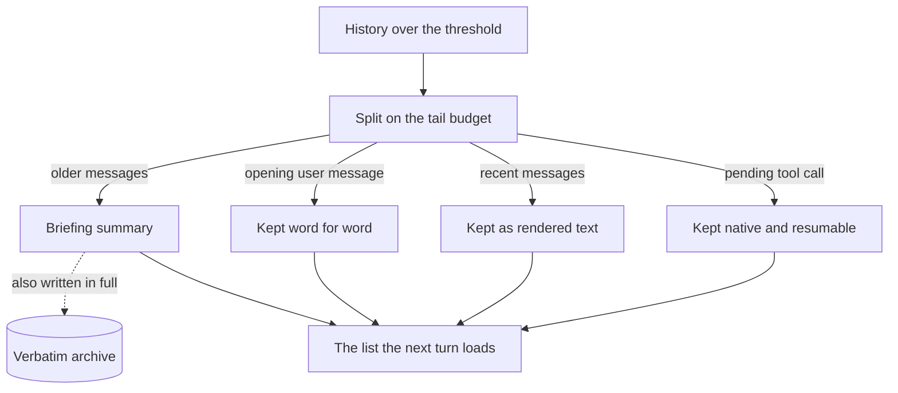

🔖 [Documentation Home](../README.md) > [Configuration](./) > [LLM Configuration](llm-config.md) > Context

# LLM Conversation Context

How long conversations are summarized, what the journal keeps across sessions, and how `/rewind` snapshots your files.

## Table of Contents

- [Summarization Thresholds](#summarization-thresholds)
  - [What happens when a conversation gets long](#what-happens-when-a-conversation-gets-long)
  - [The knobs](#the-knobs)
  - [Why the tail is smaller than the ratio it was given](#why-the-tail-is-smaller-than-the-ratio-it-was-given)
  - [The archive](#the-archive)
  - [The summary itself](#the-summary-itself)
  - [Other oversized content](#other-oversized-content)
- [Journal & Context Storage](#journal--context-storage)
- [Rewind & Snapshots](#rewind--snapshots)
  - [Python API](#python-api)
  - [`/rewind` commands](#rewind-commands)

---

## Summarization Thresholds

Zrb summarizes in the background when history or a single message grows too large, so a long conversation keeps going instead of failing against the model's context window. Three things happen, in this order:

1. **A message too big is shrunk on its own.** An oversized tool result is summarized in place before anything else is considered, so one large output never costs the whole conversation.
2. **A conversation over the threshold is compacted.** The older part is replaced by a briefing — where the work stands, what was in flight, what comes next, the decisions and the landmines — and whatever a resumed agent needs beyond prose is carried over beside it.
3. **What was replaced is archived.** Every replaced message is written word for word to a file, append-only, and the summary names that file, so detail dropped from context is still readable later.

A compacted history is therefore not just a summary. This is what the next turn loads:



Two details of that picture are easy to miss. The recent tail is rendered back into the request as text rather than resent as separate structured messages, and each tool result inside it is cut to 2,000 characters with the omitted count stated in its place — the tail is a handover, not evidence. A tool call still waiting for its result is the exception, kept as a real call so it can be resumed rather than flattened away.

### The knobs

| Variable | Description | Default |
|----------|-------------|---------|
| `ZRB_LLM_CONVERSATIONAL_SUMMARIZATION_TOKEN_THRESHOLD` | Token count triggering full history summarization. Left unset, it is recomputed on every request from the run's actual model (`/model` included): 75% of the model's known context window, or of `MAX_TOKEN_PER_REQUEST` for a model zrb doesn't recognize. Set explicitly, it is a fixed value instead | 75% of the effective context window |
| `ZRB_LLM_MESSAGE_SUMMARIZATION_TOKEN_THRESHOLD` | Token count triggering individual message summarization | 50% of conversational threshold |
| `ZRB_LLM_HISTORY_SUMMARIZATION_WINDOW` | Most messages kept verbatim after summarization | `300` |
| `ZRB_LLM_HISTORY_TAIL_BUDGET_RATIO` | Share of the summarization threshold the verbatim tail may fill. The newest messages that fit it are kept word for word instead of summarized. It is a budget, not a target: the splitter usually keeps less. Values outside `0.05`–`0.8` are clamped | `0.4` |
| `ZRB_LLM_HISTORY_TAIL_MAX_TOKENS` | Absolute ceiling on the verbatim tail, in tokens, applied on top of the ratio: whichever is smaller wins, including on the retry that fires when the newest message alone overflows. `0` leaves the ratio in charge | `24000` |
| `ZRB_LLM_SUMMARY_MAX_TOKEN_RATIO` | Share of the summarization threshold one summary may fill; a summary over it is shortened before it replaces the history. `0` disables the cap | `0.05` |

Compaction has two halves, and each is bounded differently. The summary is bounded by `ZRB_LLM_SUMMARY_MAX_TOKEN_RATIO`; the kept tail by `ZRB_LLM_HISTORY_TAIL_BUDGET_RATIO`, held under `ZRB_LLM_HISTORY_TAIL_MAX_TOKENS`, whichever of the two is smaller. The ratio on its own would allow 150,000 tokens of tail on a 500,000-token window — nearly a third of it, re-read on every later turn — which is what the ceiling is there to prevent. The summary's share on the same window is 18,750.

### Why the tail is smaller than the ratio it was given

The ratio is a budget, not a target, and the tail usually comes in under it, for three reasons worth knowing before you change the number:

- **It prefers a turn boundary.** The splitter walks back from the newest message to the earliest point that fits, and prefers a user message when that boundary still keeps at least half the budget. A budget of 0.3 and one of 0.4 can therefore produce the very same tail, because the boundary binds first.
- **The message window caps the count.** `ZRB_LLM_HISTORY_SUMMARIZATION_WINDOW` stops the tail at 300 messages regardless of tokens, which is what bounds a long session of small messages.
- **If nothing fits, the retry follows the ratio.** When even the newest message alone is bigger than the budget — one huge tool result, say — the splitter retries at twice the ratio, capped at 0.8. That retry is the only case where the tail can exceed your setting, and never by more than that factor. Only when neither budget fits is nothing kept.

Lowering the ratio makes compaction more lossy by design: the tail exists to carry recency, so a smaller tail means more of the recent conversation reaches the next request only as summary. Counting follows `ZRB_ENABLE_TIKTOKEN`; the default `char/4` estimate runs about a tenth low against a real tokenizer on code- and path-heavy text, so treat these numbers as a budget rather than a bill. The count the banner reports for the kept tail is the tail's own size, not the history it was cut from.

### The archive

What a summary replaces is also written word for word, append-only, to `<history dir>/verbatim/<session>.md` — the history directory the conversation is actually stored in, `ZRB_LLM_HISTORY_DIR` unless a custom history manager says otherwise — and, if the archive write succeeds, the summary names that file so the agent can read back the detail it dropped. The archive holds the history as the conversation held it, before oversized tool results were reduced to summaries, so a tool's output remains available after compaction.

An archive is pruned, with its lock sidecar, only once **no history refers to it**: no transcript anywhere in the history tree — the conversation's own file, a backup of it, or a delegated sub-agent's transcript under `subagent/<agent-type>/` — carries its pointer, and it is older than `ZRB_LLM_HISTORY_RETENTION` (so an archive written just before its history is saved is never mistaken for an orphan, and `0` keeps every archive). Sub-agent transcripts are searched because they point at the same shared `verbatim/` directory. That keeps the directory bounded without leaving a summary pointing at text that is gone. Archives may still contain sensitive text: protect access to the history directory and back it up as needed.

A directory written before these permissions existed is narrowed **once**, on first use, with a marker (`<dir>.owner-only`) beside it so later runs leave it alone — a mode you change back after that stays as you set it. This applies to both the history and the journal directory.

### The summary itself

The summary reaches the next model as a fenced block that names itself: it opens with `# SYSTEM: Automated Context Restoration`, says in as many words that it is derived data rather than the user speaking, and closes with an explicit end marker. Both are load bearing, because role alternation merges the summary into the same user turn as the real user messages that follow it, and without them the reader cannot tell the automation from the user. Its size is bounded by `ZRB_LLM_SUMMARY_MAX_TOKEN_RATIO`, a share of the trigger threshold rather than a fixed count, so the bound follows the model's window: 0.05 is 18,750 tokens on a 500,000-token window, with a 1,000-token floor below that. The bound is measured on the block as it will be inserted — zrb's own framing, the snapshot, the journal index and the archive pointer. A block over it is shortened at most twice and then cut, losing whole sections from the least durable end first and keeping the closing tag; a summary that arrived without the schema is bounded on the same rule rather than dropped, since an over-budget history fails the request where a bulky summary only costs tokens. If the framing and notes fill the cap on their own, the snapshot is dropped and the warning names the setting to raise. A summary that comes back empty leaves the history untouched instead.

### Other oversized content

The same mechanism keeps one large repo or file read from blowing the context window; like the conversation thresholds above, each of these is clamped to a fraction of the smaller of `MAX_TOKEN_PER_MINUTE` and `MAX_TOKEN_PER_REQUEST` (75% for those two, 40% here):

| Variable | Description | Default |
|----------|-------------|---------|
| `ZRB_LLM_REPO_ANALYSIS_EXTRACTION_TOKEN_THRESHOLD` | Token count above which repo-analysis content is extracted in chunks | 40% of `MAX_TOKEN_PER_REQUEST` |
| `ZRB_LLM_REPO_ANALYSIS_SUMMARIZATION_TOKEN_THRESHOLD` | Token count triggering summarization of repo-analysis results | 40% of `MAX_TOKEN_PER_REQUEST` |
| `ZRB_LLM_FILE_ANALYSIS_TOKEN_THRESHOLD` | Token count above which a single file's analysis is summarized | 40% of `MAX_TOKEN_PER_REQUEST` |

## Journal & Context Storage

How the journal works (storage layout, when the index is injected, how truncation behaves) is explained once, in [LLM Journal System](../technical-specs/llm-context.md). This section lists the knobs.

> **Note on White-labeling:** the `ZRB_` prefix and the `~/.zrb/` paths below are the stock build's. A white-labeled build reads its own `<PREFIX>_LLM_…` variables and derives the journal directory from its root group name (`~/.<ROOT_GROUP_NAME>/llm-notes/`, e.g. `~/.acme/llm-notes/`). See [White-labeling](../advanced-topics/white-labeling.md).

| Variable | Description | Default |
|----------|-------------|---------|
| `ZRB_LLM_JOURNAL_ENABLED` | Master switch. `false` unregisters the journal tools (`SearchJournal`, `LogActivity`, `WriteJournalNote`, `DeleteJournalNote`) and the `<journal-index>` injection. Clearing `ZRB_LLM_JOURNAL_DIR` does not disable it — that falls back to the default path | `on` |
| `ZRB_LLM_JOURNAL_DIR` | Long-term notes directory | `~/.zrb/llm-notes/` |
| `ZRB_LLM_JOURNAL_INDEX_FILE` | Filename of every journal index: the root one — the index injected into context — and one in each category and `activity-log` directory. The writers and `render_journal_index` both resolve it here, so the injected index and the catalogs behind it always agree. Set it before the first write: an existing journal keeps the indexes it already has under their old name, so a changed value starts fresh ones instead of renaming the old | `index.md` |
| `ZRB_LLM_JOURNAL_INDEX_MAX_CHARS` | Max characters of the index injected into context. Overflow is dropped from the **end** on a line boundary, so write the index most-durable-first. `0` suppresses the injection; a negative value injects it uncapped | `2500` |
| `ZRB_LLM_JOURNAL_HUD_MAX_ENTRIES_PER_SECTION` | Max `hud_line` entries per root-index HUD section (User, Preferences, Agent, Active Constraints); oldest evicted first. `<= 0` disables the cap | `20` |
| `ZRB_LLM_JOURNAL_AUTO_SEARCH_ENABLED` | On a session's first turn, run one `SearchJournal` against the opening message and fold hits into `<journal-index>` under an unverified "Possibly Related" section. Costs one search subprocess per session | `on` |
| `ZRB_LLM_JOURNAL_AUTO_SEARCH_MAX_HITS` | Max `SearchJournal` hits folded into the first-turn auto-search | `3` |
| `ZRB_LLM_JOURNAL_GIT_ENABLED` | Git-back the journal directory: `git init` on first use, commit after every `LogActivity`/`WriteJournalNote`/`DeleteJournalNote`. Gives unbounded, diffable history, so a human can recover a delete or bad overwrite (the in-file History block keeps only 3 revisions). Best-effort: a missing `git` or failed commit only skips the commit | `on` |
| `ZRB_LLM_JOURNAL_LOCK_TIMEOUT` | Seconds to wait for another journal writer's lock before returning a busy-journal error; `<= 0` fails immediately. Does not limit git work *after* acquiring the lock | `30` |
| `ZRB_LLM_SELF_REVIEW_ENABLED` | Built-in self-review Stop hook. On a turn that changed files, a fresh-context reviewer reads the working directory's diff since the turn started (every repository under it, nested ones and worktrees included; shell edits and mid-turn commits included; earlier uncommitted work excluded) plus read-only surrounding code. A `Request changes` verdict extends the turn so the agent fixes the findings. Snapshots go to a private temporary git store, never your `.git/objects`. Costs two snapshots per turn (start and Stop) and one reviewer run per turn that changed files | `off` |
| `ZRB_LLM_SELF_REVIEW_MAX_ROUNDS` | Consecutive blocking reviews in one turn before it ends anyway; a non-blocking review resets the count | `2` |
| `ZRB_LLM_SELF_REVIEW_MODEL` | Reviewer model. Empty uses the run's model; a different model shares fewer blind spots | (empty) |
| `ZRB_LLM_SELF_REVIEW_TIMEOUT` | Seconds per review. On timeout the reviewer (and its model request) is cancelled and the turn ends unreviewed | `240` |
| `ZRB_LLM_SELF_REVIEW_MAX_TRACKED_TURNS` | Turns whose blocking-review count is kept at once; a turn that ends mid-continuation never clears its own, so the oldest past this are dropped | `64` |
| `ZRB_LLM_HISTORY_DIR` | Conversation history directory | `~/.zrb/llm-history/` |
| `ZRB_LLM_HISTORY_RETENTION` | How long a conversation with a generated name (like `bold-arch-1234`, or `bold-arch-1234-greetings` once auto-named) is kept after its last save, backups included (`30d`, `2w`, …; `0` = keep all). A conversation you named — with `/save` or your own session name — is never pruned, unless the name you typed itself starts with a generated name such as `bold-arch-1234-`, which retention reads as an auto-named one. Pruned on the first save of each session | `30d` |
| `ZRB_LLM_AUTO_NAME_ENABLED` | Rename a conversation that still has its generated name, after its first message, to `<generated-name>-<topic>` (e.g. `bold-arch-1234-greetings`) using the small model. A name you chose is never renamed. Sub-agent transcripts and live sessions keep the generated name as their key, and each new sub-agent gets a topic title in the picker | `on` |
| `ZRB_LLM_AUTO_NAME_MODEL` | Model that names a conversation. Empty uses the small model (`ZRB_LLM_SMALL_MODEL`, else the main model) | empty |
| `ZRB_LLM_HISTORY_BACKUP_RETAIN` | Number of timestamped history backups to keep per conversation (`-1` = keep all, `0` = disable) | `3` |
| `ZRB_LLM_ARCHIVE_LOCK_TIMEOUT` | Seconds a verbatim archive append waits for another writer, so a rollback truncates only its own bytes. On timeout nothing is written and the summary carries no pointer (`0` = fail at once) | `30` |
| `ZRB_LLM_AGENT_MESSAGE_LIMIT` | Max messages the main agent and one delegated sub-agent may send each other (both directions together) before `SendMessageToSubagent` / `SendMessageToParent` refuse, so two agents cannot answer each other forever. Human messages do not count | `20` |
| `ZRB_LLM_SUBAGENT_HISTORY_RETAIN` | Max sub-agent transcripts kept across all agent types (`-1` = keep all); oldest pruned on each new delegation. Transcripts live under `ZRB_LLM_HISTORY_DIR/subagent/<agent-type>/` | `50` |
| `ZRB_LLM_PREVIOUS_MESSAGE_HISTORY_DIR` | Directory of the cross-session history of submitted messages that `↑`/`↓` recall in the chat input box | `~/.zrb/llm-previous-message-history/` |
| `ZRB_LLM_PREVIOUS_MESSAGE_HISTORY_MAX_ENTRIES` | Most messages that history keeps; oldest dropped first (`0` = keep all) | `1000` |

## Rewind & Snapshots

Before each AI turn, Zrb snapshots your working directory so `/rewind` can restore any earlier state mid-session.

**How it works:** each snapshot is a commit in a private git store under `ZRB_LLM_SNAPSHOT_DIR` whose work tree is your directory, so nothing is copied and your own repositories' history, index and objects are never touched. Every repository under the directory is snapshotted by its own `.gitignore` (nested clones and submodules included); files outside any repository are taken as they are, minus common cache directories (`node_modules/`, `.venv/`, `__pycache__/`, …). Each conversation keeps its own rewind history: `/load` switches to the loaded conversation's history, and `/save` copies the current one to the new name.

**Limits and guarantees:**

- Files a repository's `.gitignore` excludes (even ones excluded only after a snapshot) are neither snapshotted nor restored — an edit to a gitignored `.env` is not rewound. A `.gitignore` outside any repository has no effect, as in git.
- Outside every repository, a directory may hold at most 5,000 files or 200 MB (`ZRB_LLM_SNAPSHOT_LOOSE_MAX_FILES`, `ZRB_LLM_SNAPSHOT_LOOSE_MAX_MB`). Past that (e.g. a chat started in `~`), or when `ZRB_LLM_SNAPSHOT_DIR` is the working directory itself, rewind turns off for the session and says why at startup and on `/rewind`.
- Rewind restores files, nested repositories' included, but never moves a repository's `HEAD` or branches, and leaves a repository created since the snapshot (a worktree or clone) alone.
- It removes a file only if the snapshot would have held it (never one that was ignored or unreadable then), and never overwrites a file it cannot read now.
- If a file cannot be written (held open, or read-only folder), the rest are still restored, `/rewind` names what was left behind, and re-running the same `/rewind` finishes the job.
- A file larger than 50 MB (`ZRB_LLM_SNAPSHOT_FILE_MAX_MB`) is left out, as if ignored: rewind neither restores nor removes it.
- Without git on `PATH`, rewind is off; startup says nothing, `/rewind` says why.
- A conversation's rewind history is dropped once its newest snapshot is older than `ZRB_LLM_SNAPSHOT_RETENTION` (never the current conversation's), and `git gc --auto` then packs the repository and prunes what no history holds.

| Variable | Description | Default |
|----------|-------------|---------|
| `ZRB_LLM_ENABLE_REWIND` | Enable filesystem snapshots and `/rewind` command | `on` |
| `ZRB_LLM_SNAPSHOT_DIR` | Directory holding one snapshot git repository per working directory. Must not be the working directory itself | `~/.zrb/llm-snapshots/` |
| `ZRB_LLM_SNAPSHOT_FILE_MAX_MB` | A file larger than this is left out of every snapshot (rewind's and self-review's), as if ignored | `50` |
| `ZRB_LLM_SNAPSHOT_LOOSE_MAX_FILES` | Most files taken from outside every git repository; past it, rewind is off for the session | `5000` |
| `ZRB_LLM_SNAPSHOT_LOOSE_MAX_MB` | Most MB taken from outside every git repository; past it, the same | `200` |
| `ZRB_LLM_SNAPSHOT_COMMAND_TIMEOUT` | Seconds one snapshot git command may take before it is killed | `30` |
| `ZRB_LLM_SNAPSHOT_OPERATION_TIMEOUT` | Seconds one rewind snapshot or restore may take as a whole, once it holds the store; running out turns rewind off for the session | `120` |
| `ZRB_LLM_SNAPSHOT_LOCK_TIMEOUT` | Seconds a rewind operation waits for another session's operation on the same directory before that one operation fails | `60` |
| `ZRB_LLM_SNAPSHOT_RETENTION` | How long a conversation's rewind history is kept after its newest snapshot (`30d`, `2w`, …; `0` = keep all). Checked when a session starts in the same directory | `30d` |

### Python API

```python
from zrb import LLMChatTask

task = LLMChatTask(
    name="chat",
    enable_rewind=True,           # None → falls back to ZRB_LLM_ENABLE_REWIND
    snapshot_dir="/tmp/my-snaps", # None → falls back to ZRB_LLM_SNAPSHOT_DIR
)
```

### `/rewind` commands

| Input | Effect |
|-------|--------|
| `/rewind` | List the current conversation's snapshots (newest first) with index, short SHA, timestamp, and user message |
| `/rewind <n>` | Restore snapshot number `n` from the list (1-based) |
| `/rewind <sha>` | Restore by full or partial SHA |

Restoring rewinds **both** files and conversation history, so the AI's context matches the restored files.
