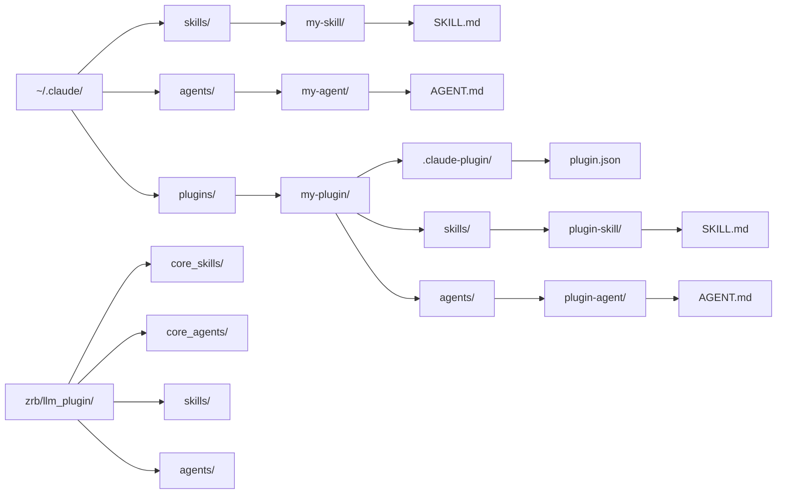

🔖 [Documentation Home](../README.md) > [Configuration](./) > [LLM Configuration](llm-config.md) > Tools

# LLM Tools & Extensions

The agent's tools and what feeds them: web search, hooks, skill and agent discovery, language servers, and the sandbox.

## Table of Contents

- [Search Engine Configuration](#search-engine-configuration)
  - [Google News RSS (Default)](#google-news-rss-default)
  - [SerpAPI (Google)](#serpapi-google)
  - [Brave Search](#brave-search)
  - [SearXNG (Self-hosted)](#searxng-self-hosted)
- [Web Fetch Configuration](#web-fetch-configuration)
- [LLM Hooks Configuration](#llm-hooks-configuration)
- [Skill & Agent Search Configuration](#skill--agent-search-configuration)
  - [Search Priority](#search-priority)
  - [Directory Structure](#directory-structure)
- [LSP Server Selection](#lsp-server-selection)
- [Shell Command Judge](#shell-command-judge)
- [Sandbox Configuration](#sandbox-configuration)

---

## Search Engine Configuration

Which internet search engine the LLM tools use.

| Variable | Description | Default |
|----------|-------------|---------|
| `ZRB_SEARCH_INTERNET_METHOD` | Search engine (`google_rss`, `serpapi`, `brave`, `searxng`) | `google_rss` |

### Google News RSS (Default)

Free; reads the Google News RSS feed. No API key, Docker, or configuration needed.

### SerpAPI (Google)

| Variable | Description | Default |
|----------|-------------|---------|
| `SERPAPI_KEY` | API key | (required) |
| `ZRB_SERPAPI_LANG` | Language | `en` |
| `ZRB_SERPAPI_SAFE` | Safe search | `off` |

### Brave Search

| Variable | Description | Default |
|----------|-------------|---------|
| `BRAVE_API_KEY` | API key | (required) |
| `ZRB_BRAVE_API_LANG` | Language | `en` |
| `ZRB_BRAVE_API_SAFE` | Safe search | `off` |

### SearXNG (Self-hosted)

| Variable | Description | Default |
|----------|-------------|---------|
| `ZRB_SEARXNG_PORT` | Port | `8080` |
| `ZRB_SEARXNG_BASE_URL` | Base URL | `http://localhost:8080` |
| `ZRB_SEARXNG_LANG` | Language | `en-US` |
| `ZRB_SEARXNG_SAFE` | Safe search | `0` |

## Web Fetch Configuration

`WebFetch` opens `http` and `https` URLs only, and only when the host resolves to a public address. The check runs before both the Playwright page and the plain-HTTP fallback. Without it a `file://` URL would return a local file to the model — the sandbox deny-read list is the reason the file tools cannot read it — and a loopback, private, link-local or cloud-metadata host would turn a fetch into a request into the local network.

Every redirect hop is re-checked the same way, because a public URL can bounce a fetcher inward. The HTTP path follows at most five redirects by hand, validating each `Location`; the browser aborts any main-frame, iframe or subresource request whose URL fails the guard. Every browser request is checked on its own — a host that passed once is not remembered.

By default `WebFetch` does not use the browser. Chromium resolves hostnames with its own resolver, so the address the guard validated is not necessarily the address Chromium connects to; a separate lookup between validation and connection is a DNS-rebinding window. The public-only path resolves each hop once and pins the connection to that address: the `Host` header and TLS SNI/certificate verification still name the URL's hostname, and every redirect hop is validated and pinned again. The plain-HTTP path connects directly, so an HTTP proxy in the environment is not used for it. With `ZRB_LLM_WEB_ALLOW_PRIVATE_HOSTS=on`, private destinations are intentional, so the Playwright page is used again for JavaScript-rendered pages. Chromium is pointed at a loopback CONNECT proxy; the proxy resolves each request target, refuses a non-public answer unless `ZRB_LLM_WEB_ALLOW_PRIVATE_HOSTS=on`, tries the addresses in turn, and tunnels the browser's bytes to the socket it opened. Chromium never resolves the name, so the check-then-connect gap closes while rendering still works. The per-request `page.route` guard stays as a second layer.

| Variable | Description | Default |
|----------|-------------|---------|
| `ZRB_LLM_WEB_ALLOW_PRIVATE_HOSTS` | Allow `WebFetch` to open a host that resolves to a loopback, private, link-local, multicast, reserved or unspecified address. Off reaches public hosts only; on suits a deployment that fetches from `localhost` or an intranet host. | `off` |

```bash
export ZRB_LLM_WEB_ALLOW_PRIVATE_HOSTS=on
```

## LLM Hooks Configuration

These knobs control the hook subsystem as a whole; each hook's own `enabled`/`timeout` fields and the hook file format are in the [Hooks Guide](../llm/hooks.md).

| Variable | Description | Default |
|----------|-------------|---------|
| `ZRB_HOOKS_ENABLED` | Enable the hook system globally; set `off` to disable all hooks (none load or fire) | `on` |
| `ZRB_HOOKS_DIRS` | Additional directories to scan for hook files (colon-separated; semicolon on Windows) | (empty) |
| `ZRB_HOOKS_TIMEOUT` | Default timeout for hook execution (ms) | `30000` |
| `ZRB_HOOKS_EXIT_TIMEOUT` | How long the chat TUI waits, as it exits, for hooks still running (ms): first a Stop hook Ctrl+C fired, then SessionEnd and detached (`async`) hooks sharing one budget. An agent hook still gets its own `timeout` | `2000` |
| `ZRB_LLM_HOOKS` | Name allowlist for the hooks zrb dispatches — the env twin of `hook_registry`. Empty means all registered hooks; non-empty restricts dispatch to the named hooks. The built-in memory hooks have names of their own: an allowlist of `memory-reviewer` alone keeps the reviewer's model call and drops `memory-event-log` and `memory-interrupt-log`, so the day records nothing, drops `memory-recall`, so a prompt stops surfacing the claims it names, and drops `memory-week`, so no week is ever closed — name all five. Finer edits (a hook with a matcher, command config) live in `zrb_init.py` via `hook_registry`. See [LLM Component Collections](./llm-collections.md). | (empty) |

`ZRB_HOOKS_ENABLED=off` disables the subsystem regardless of any `hooks.json`. `ZRB_LLM_HOOKS` filters on top of it: with the subsystem off, nothing fires even if a hook's name is allowed.

## Skill & Agent Search Configuration

Where Zrb looks for skills and agents, and whether built-in ones load.

| Variable | Description | Default |
|----------|-------------|---------|
| `ZRB_LLM_SEARCH_PROJECT_ENABLED` | Search project dirs (filesystem root → cwd) for config dir names | `on` |
| `ZRB_LLM_SEARCH_HOME_ENABLED` | Search home directory (`~/.claude/`, `~/.zrb/`) | `on` |
| `ZRB_LLM_BUILTIN_SKILLS_ENABLED` | Load the built-in utility skills (`llm_plugin/skills`). Core skills (`core_skills/`) are always on; user/project/plugin skills are unaffected | `on` |
| `ZRB_LLM_BUILTIN_AGENTS_ENABLED` | Load optional built-in sub-agents (`llm_plugin/agents`). Core agents (`core_agents/`) are always on; user/project/plugin agents are unaffected | `on` |
| `ZRB_LLM_SKILLS` | Name allowlist for the visible skill catalogue — the env twin of `skill_registry`. Empty means all discovered + built-in skills; non-empty keeps only the named ones (`LLM_BUILTIN_SKILLS_ENABLED` still gates built-ins independently). See [LLM Component Collections](./llm-collections.md). | (empty) |
| `ZRB_LLM_AGENTS` | Name allowlist for the sub-agent roster — the env twin of `sub_agent_registry`. Empty means all discovered + built-in agents; non-empty keeps only the named ones. See [LLM Component Collections](./llm-collections.md). | (empty) |
| `ZRB_LLM_CONFIG_DIR_NAMES` | Config subdirectory names to look for in each dir (colon-separated; semicolon on Windows). An absolute path is a root of its own, scanned once in the home tier — `$CLAUDE_CONFIG_DIR` belongs here | `.claude:.zrb` |
| `ZRB_LLM_BASE_SEARCH_DIRS` | Explicit base dirs containing `skills/`, `agents/`, `plugins/` | (empty) |
| `ZRB_LLM_EXTRA_SKILL_DIRS` | Additional direct skill directories | (empty) |
| `ZRB_LLM_EXTRA_AGENT_DIRS` | Additional direct agent directories | (empty) |
| `ZRB_LLM_PLUGIN_DIRS` | Additional plugin directories | (empty) |

### Search Priority

Zrb scans these sources in order, and when two define a skill or agent with the same name, the later one wins (lowest to highest priority):

1. **Core Builtins** - `core_skills/` and `core_agents/` (always included)
2. **Optional Builtins** - `skills/` and `agents/` (controlled by their built-in toggles)
3. **User Home** - `~/.claude/`, `~/.zrb/` + plugins within
4. **Project Traversal** - Filesystem root → cwd for each config dir name + plugins within, so the directory nearest cwd wins
5. **Configured Plugins** - Directories in `ZRB_LLM_PLUGIN_DIRS`
6. **Base Search Dirs** - Directories in `ZRB_LLM_BASE_SEARCH_DIRS` + plugins within
7. **Extra Direct Dirs** - `ZRB_LLM_EXTRA_SKILL_DIRS`, `ZRB_LLM_EXTRA_AGENT_DIRS`

A project or home skill named like a built-in one (`core-coding`, say) replaces it.

### Directory Structure



## LSP Server Selection

LSP-backed tools (`AnalyzeCode`, the `Lsp*` tools) pick a server per file: your preference first, then the first *installed* server (command on `PATH`) matching the file's extension.

| Variable | Description | Default |
|----------|-------------|---------|
| `ZRB_LLM_LSP_PREFERRED_SERVERS` | Ordered, comma-separated LSP server names the agent prefers when multiple installed servers match a file (e.g. `pyright,gopls`). Names not matching a file are skipped, so one flat list can cover several languages. | (empty) |

```bash
export ZRB_LLM_LSP_PREFERRED_SERVERS="pyright,gopls"
```

```python
from zrb import CFG
CFG.LLM_LSP_PREFERRED_SERVERS = ["pyright", "gopls"]
```

Empty (default) uses installation/registry order. See [LSP Support](../llm/lsp-support.md) for the full rules and a per-call override.

## Git Worktrees

`EnterWorktree` creates a linked git worktree so a delegated or exploratory change can be made without touching the checkout you are working in. The tools are registered only when zrb starts inside a git repository.

| Variable | Description | Default |
|----------|-------------|---------|
| `ZRB_LLM_WORKTREE_DIR` | Where linked worktrees are created. A relative value is resolved against the directory zrb was started in. Each repository gets its own `<repo>-<digest>` subdirectory inside it, so two checkouts that share a name never share a path. | `~/.zrb/wt` |

```python
from zrb import CFG
CFG.LLM_WORKTREE_DIR = "/Volumes/fast/worktrees"
```

A worktree under `LLM_WORKTREE_DIR` is outside the checkout on purpose: one nested in the repository is a second copy of it that every `Grep`, `Glob` and `git status` would have to skip.

In a sandboxed session the sandbox judges the destination, so `LLM_WORKTREE_DIR` has to be writable — **and the repository has to stay writable with it**. `git worktree add` records the new branch and the worktree's own files inside the repository (`.git/refs/heads/<branch>`, `.git/worktrees/<name>`), so a writable list that names the worktree root *instead of* the project stops here with git's own "Operation not permitted" on a `.git` lock, and stops every edit in the project too. With an explicit list, add it alongside the project:

```bash
export ZRB_LLM_SANDBOX_WRITABLE_PATHS="$PWD:$HOME/.zrb/wt"
```

Leaving `LLM_SANDBOX_WRITABLE_PATHS` empty is the automatic set: the current directory, the system temp directory, and `LLM_WORKTREE_DIR`. The default configuration therefore needs no entry.

## Shell Command Judge

One small-model opinion on whether a shell command looks like what it says, written as one line above the approval prompt. Off by default, in both halves.

| Variable | Description | Default |
|----------|-------------|---------|
| `ZRB_LLM_SHELL_JUDGE_ENABLED` | Judge each `Shell` call that reaches the prompt: one small-model call, one line saying what it saw. Costs a call per judged command and grants nothing. | `off` |
| `ZRB_LLM_SHELL_JUDGE_AUTO_APPROVE_ENABLED` | A `safe` verdict skips the prompt entirely. Meaningless without the first knob. Costs the judge's misses. | `off` |

```python
from zrb import CFG
CFG.LLM_SHELL_JUDGE_ENABLED = "on"
CFG.LLM_SHELL_JUDGE_AUTO_APPROVE_ENABLED = "on"
```

The judge answers `safe`, `caution`, `dangerous`, or `unknown`. Only `safe` — *with a reason*, since a bare `SAFE:` is read as `unknown` — may skip a prompt, and only when nothing above it in the [precedence chain](../llm/permission-policy.md#the-precedence-chain) said ask: a permission `ask` you wrote, a `PreToolUse` hook's `permissionDecision: "ask"`, and a call carrying `dangerously_skip_sandbox` all still reach a person however ordinary the command is. A judge that times out (20 seconds) or fails answers `unknown`, and the prompt then says the command went unjudged.

It is **reasoning-blind** on purpose: it reads the command, the directory, whether the sandbox is off, and how many uncommitted files the repository holds. Not the conversation, not the assistant's own text. And it is not a security boundary — that is the [sandbox](llm-tools.md#sandbox-configuration); this is a prompt filter that fails closed. [ADR-0141](../adr/adr-0141.md) records the placement and the reasoning.

Its spend shows in `/usage` as the `shell_judge` row of *Who spent it*. The prompt it produces is in [Customizing Tool Approval](../llm/tool-approval.md).

Inside a conversation, `/judge` (`ZRB_LLM_UI_COMMAND_JUDGE`) switches the first knob for that session, and `/judge on` / `/judge off` names the state. It cannot reach the second: a switch that lets a verdict skip the prompt removes a person from the loop, and that is a deployment's decision rather than a keystroke's. The choice is obeyed by the next judged command, including one inside a turn already running, and it leaves both settings as the deployment wrote them — a second session in the same process keeps its own.

When a verdict skips the prompt, the `PermissionRequest` hook never fires. Nothing is being asked, and a hook that announces the prompt — the speech feature reads it aloud — would be describing a question nobody will answer. The judge settles before that event for exactly this reason, so a `safe` command reaches a hook only when some other level has already decided a person has to be asked.

## Sandbox Configuration

Opt-in filesystem containment for LLM tool calls, off by default. Its six knobs — `ZRB_LLM_SANDBOX_ENABLED`, `ZRB_LLM_SANDBOX_OS_SHELL`, `ZRB_LLM_SANDBOX_WRITABLE_PATHS`, `ZRB_LLM_SANDBOX_DENY_READ_PATHS`, `ZRB_LLM_SANDBOX_FALLBACK`, `ZRB_LLM_SANDBOX_ALLOW_ESCAPE_ENABLED` — are documented with the model they configure in [Sandbox](../llm/sandbox.md#configuration).
