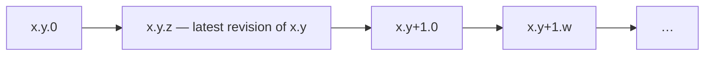
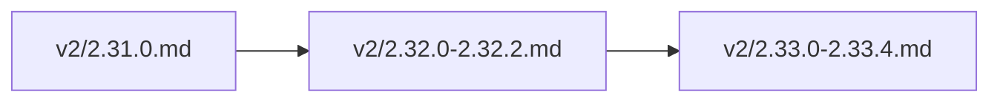

🔖 [Documentation Home](../README.md) > [Contributing](./) > Releasing

# Releasing Zrb

Two jobs that share a version: what a release note says, and how the release reaches PyPI. Every change that ships needs a changelog entry; a maintainer cuts the release from it. Environment and tests are in the [Maintainer Guide](maintainer-guide.md).

## Table of Contents

- [Changelog](#changelog)
  - [Writing an entry](#writing-an-entry)
  - [Collapsing (compaction)](#collapsing-compaction)
- [Publishing Zrb](#publishing-zrb)
  - [About `README.pypi.md`](#about-readmepypimd)
- [API Reference](#api-reference)

---

## Changelog

The changelog lives under `docs/changelog/`:

| Path | Scope |
|------|-------|
| `README.md` | Index page listing every minor version with links. |
| `v2/` | Per-minor-version files for the 2.x line (e.g. `2.38.0.md`, `2.35.0-2.35.3.md`). |
| `v3/` | Per-minor-version files for the 3.x line (e.g. `3.0.0.md`). |
| `v1.md` | Archive of the 1.x line (and the 1.0.0 rewrite from 0.x). |

### Writing an entry

Each release is a `## <version> (<Month D, YYYY>)` heading followed by one contiguous bullet list — no blank lines between entries:

```markdown
## 2.33.0 (June 6, 2026)

- **Feature: <Title>** (`path/to/module.py`, `test/path/to/test_module.py`): <what
  changed and why, past tense, anchored to concrete symbols>.
- **Fix: <Title>** (`path/to/module.py`): <the wrong behavior, then the new
  behavior>. Name the release that introduced it when fixing a shipped bug, so a
  reader can tell whether their version is affected.
```

- One flat `- **<Category>: <Title>** (`paths`): <prose>` bullet per change. No sub-bullets; a change too big for one bullet is usually two changes.
- Categories are free-form but conventionally `Feature` / `Improvement` / `Fix` / `Reliability` / `Security` / `Refactor` / `Performance` / `Chore` / `Documentation` / `Tests`.
- Past tense, factual, and anchored to something locatable (`module.py`, `ClassName`, an env var, `ADR-NNNN`).
- Say what changed for the user: the new behavior, a changed default, a migration step, a headline number. The mechanism belongs in the ADR or doc the bullet cites, so a bullet that keeps it duplicates a record that will be rewritten while the changelog is not. Aim for under ~120 words.

### Collapsing (compaction)

Each patch release first lands in its own file under its line's directory (`v2/`, `v3/`). Once a minor ages out (a later minor opens), its per-patch files are merged into one range file that **keeps only two entries** — the minor bump and its final revision:



Worked example (2.31–2.33):



`2.31` had no patches (stays `2.31.0.md`); `2.32` collapsed `2.32.1` into `2.32.2` and its `2.32.0a1`–`b5` pre-releases into `2.32.0`; `2.33`, once it aged out, merged `2.33.1.md`–`2.33.4.md` into `2.33.4` in `2.33.0-2.33.4.md`. **The newest minor stays as separate per-patch files.**

The surviving entries must not lose the dropped history:

- The kept **`x.y.z` (latest)** entry **summarizes the cumulative changes** of every dropped patch `x.y.1`–`x.y.z`, not merely its own.
- The kept **`x.y.0`** entry **absorbs its pre-releases** (`x.y.0a*`/`x.y.0b*`). Headline features usually land there (the stable `.0` note often just says "consolidating the pre-release line below"), so dropping them without folding loses the real content.
- Mark a rolled-up entry with a one-line italic note under the heading: `_Cumulative summary of the X.Y.1–X.Y.Z patch line._`
- **Summarize, don't concatenate.** A 24-patch line becomes one release-note-sized entry grouped by theme; drop version-bump noise and test-only churn (one "expanded test coverage" mention suffices).
- Update `README.md` when renaming a file (e.g. `2.38.0.md` → `2.38.0-2.38.3.md`).

Dropped content stays recoverable from git, but the compacted file should convey what happened without it.

---

## Publishing Zrb

You need a [PyPI](https://pypi.org/) (or [TestPyPI](https://test.pypi.org/)) account and API token. Configure the token once, then publish:

```bash
poetry config pypi-token.pypi <your-api-token>
```

```bash
source ./project.sh
docker login -u stalchmst
zrb publish all
```

### About `README.pypi.md`

`pyproject.toml` points at `README.pypi.md`, not `README.md`. They differ only in `docs/X` link format:

| File | Link format | Purpose |
|------|-------------|---------|
| `README.md` | Relative (`docs/foo.md`) | Single source of truth — works locally, on GitHub, and offline |
| `README.pypi.md` | Absolute, tag-pinned (`https://github.com/state-alchemists/zrb/blob/2.25.3/docs/foo.md`) | Generated artifact — packaged by Poetry, shown on PyPI |

`README.pypi.md` is **gitignored** and generated by `scripts/build_pypi_readme.py`, which reads the version from `pyproject.toml` and rewrites every relative `docs/X` link to a tag-pinned GitHub URL, so `pypi.org/project/zrb/2.25.3/` always shows the docs as of that release. It is generated automatically by:

- `source ./project.sh` — before `poetry install`, so a fresh clone has the file.
- `zrb publish pip` — before `poetry publish --build`, so each release links to its own tag.

If you run `poetry build` / `poetry publish` directly, run `python scripts/build_pypi_readme.py` first or Poetry fails with "readme not found."

> ⚠️ **Tag format.** Release tags are bare `major.minor.patch` (e.g. `2.25.3`, no `v` prefix), and the script generates `/blob/2.25.3/...` accordingly. Keep this if you rewrite the URL template.

---

## API Reference

`./zrb-api-doc.sh [outdir]` renders the public API from docstrings into `dist/api` (gitignored, default outdir), using the annotations `src/zrb/py.typed` exposes to consumers.

It uses `pdoc` rather than `mkdocstrings` because `docs/` is plain markdown with no `mkdocs.yml`, and adopting mkdocs for one reference isn't worth it. The output is not committed: it regenerates from source, so a checked-in copy would only go stale.

Two tests keep the input complete: `test_public_api_docs.py` requires a docstring on every public member of every exported class and a documented parameter for every constructor argument a class adds; `test_public_api_contract.py` pins the surface against `public_api_snapshot.json`.

---

🔖 [Documentation Home](../README.md) > [Contributing](./) > Releasing
