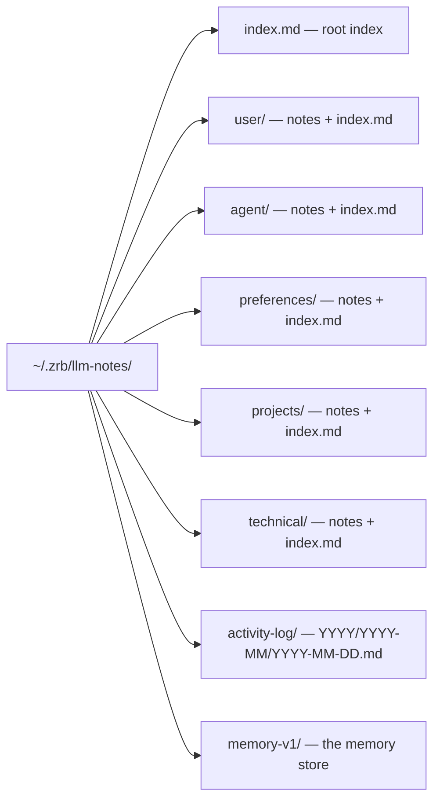

🔖 [Documentation Home](../README.md) > [Technical Specs](./llm-context.md)

# LLM Notes Directory (Historical)

> **The journal and its code were removed in 3.33.0.** The memory store replaced it ([LLM Memory](./llm-memory.md), [ADR-0138](../adr/adr-0138.md)), and every module, tool, setting and hook this page used to document is gone — there is nothing here you can switch on. What survives is one description: the layout of an `~/.zrb/llm-notes` directory an older zrb wrote. That layout is still read, once, into the store, so the format has to stay written down after the system that wrote it stopped existing.

The notes directory is `ZRB_LLM_NOTES_DIR` — `~/.zrb/llm-notes/` by default, and `~/.<ROOT_GROUP_NAME>/llm-notes/` in a white-labeled build. It holds notes, an activity log, and the indexes an older build rendered from them. The memory store lives inside it as `memory-v1`, and the notes an existing directory already contains are read into that store on first use, or explicitly with `zrb memory migrate` (§4).

---

## Table of Contents

- [1. Storage Layout](#1-storage-layout)
- [2. A Note](#2-a-note)
- [3. The Day Files](#3-the-day-files)
- [4. Reading These Notes Into Memory](#4-reading-these-notes-into-memory)

---

## 1. Storage Layout

A notes directory a journal wrote looks like this — the layout is described here, and nothing in today's code creates it:

The five category directories are the only places `migrate` looks for notes, and `activity-log/` the only place it looks for days. `index.md` files are skipped: indexes, backlinks and the rendered HUD lines have no counterpart in the store.

---

## 2. A Note

A note is `<category>/<slug>.md`: a frontmatter block, then a `# Title`, an optional `## Context`, a `**Finding:**` paragraph, and an optional `## Source`. The frontmatter is what the migration reads.

| Key | Meaning | What the migration does with it |
|---|---|---|
| `slug` | The note's identity inside its category | Becomes the fact's `id`, category-prefixed when two categories share a slug. A note with no `slug` is skipped |
| `hud_line` | One line stating what the note claims, and the line the index showed | Becomes the fact's `claim`. Absent, the first sentence of `**Finding:**`, then the `# Title`, is used |
| `applies_when` | When the note stops holding: prose, or a `file:` / `version:` / `setting:` / `date:` form an older build could check | Kept verbatim as prose. The `not stated` placeholder an early version stored is dropped |
| `applies_when_digest`, `applies_when_checkout` | The hash and the checkout a `file:` condition was stamped with | Nothing — the evaluator that read them is gone |
| `status` | `active`, or `superseded` once another note replaced it | `superseded` becomes a retired fact with `reason: stale` |
| `superseded_by` | `<category>/<slug>` of the note that replaced it | Nothing — the retirement is recorded, the pointer is not |
| `pinned` | `true` when the note was meant to hold every turn | The fact's `pin`, so the claim lands in `core.md` |
| `keywords` | Comma-separated lower-case words | The fact's `tags` after the category, at most six of them, each longer than two characters |
| `repo` | The repository the note is about, or absent | Nothing — the fact carries the category as its tag instead |
| `updated` | When the note was last written | The fact's `updated` |

The body above the first `## ` heading — title removed — becomes the fact's body, which is evidence and is never injected.

---

## 3. The Day Files

`activity-log/YYYY/YYYY-MM/YYYY-MM-DD.md` is one day. It holds a `- HH:MM — text` line per event, and a `## Handover` section: the state of play a session's first turn used to read.

Line metadata the journal grew lives inside the text and is dropped on the way in:

| In the file | Why the journal had it | In `log/` |
|---|---|---|
| `· imp 7` | ranked "today's five most important" | dropped |
| `· project:bank` | grouped the day's line under a project for the week view | becomes the line's `(bank)` tag |
| `Files: a.py, b.py` | listed the files an event touched | dropped |

`## Handover` becomes that day's diary entry: the section's text is the `handover` field, its first sentence the `claim`, and `source: migrated`. A day file with no handover gets no diary entry — deriving a claim from the day's lines would be a guess wearing a date. Prose after the last log line counts as a handover when the heading is absent.

A day's log is merged, never rewritten: the reviewer writes into the same `log/<YYYY-MM-DD>.md`, so only lines the store does not already hold are added, sorted by clock time.

---

## 4. Reading These Notes Into Memory

Two paths read the directory, and both use `src/zrb/llm/memory/migrate.py`:

- **First use.** When the store has not been converted and still lives inside the notes directory (the default layout), the first memory operation converts: `paths.prepare()` reads the notes, writes the store, and only then writes `.version` at the notes root (`src/zrb/llm/memory/paths.py`, `src/zrb/llm/memory/migrate.py`). An upgrade that silently started an empty memory would look exactly like a memory that was lost.
- **The command.** `zrb memory migrate` does the same pass on demand, reading `CFG.LLM_NOTES_DIR`; `--dry_run=true` counts what it would write. It is the way to fill a store that was pointed somewhere else, and the way to see the counts before they exist.

Both are additive: no note is edited or deleted, a run interrupted by a crash continues on the next start rather than duplicating, and a second run changes nothing. What a migrated store contains, and the fact-by-fact mapping, is [LLM Memory → From the journal notes](./llm-memory.md#91-from-the-journal-notes).

🔖 [Documentation Home](../README.md) > [Technical Specs](./llm-context.md)
