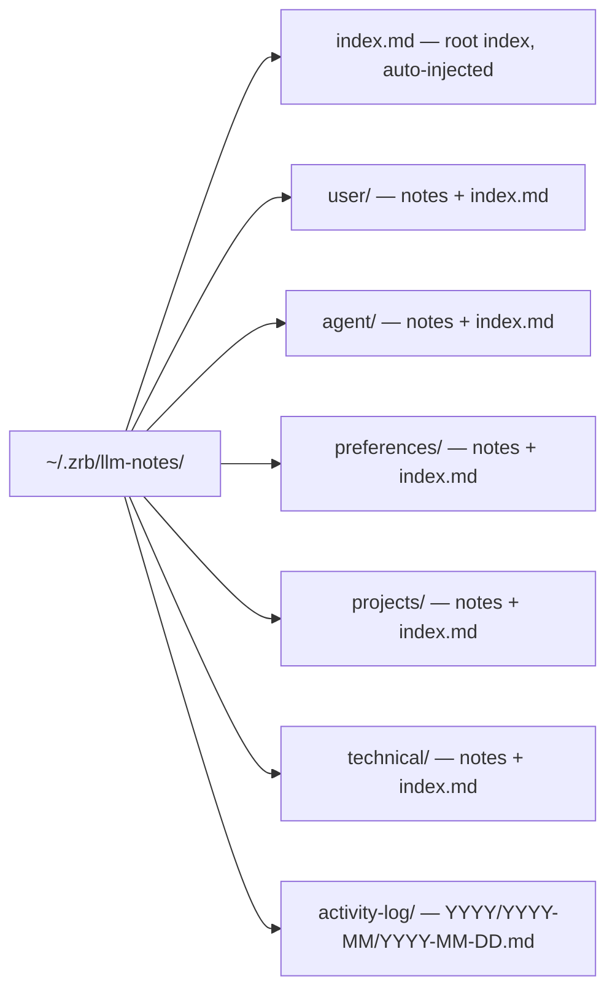

🔖 [Documentation Home](../README.md) > [Technical Specs](./llm-context.md)

# LLM Journal System (Technical Specification)

Zrb provides a directory-based journal system for maintaining persistent context across LLM sessions. This allows the assistant to remember project-specific details, user preferences, and local environment information through a hierarchical file system structure.

---

## Table of Contents

- [Overview](#1-overview)
- [Storage Mechanism](#2-storage-mechanism)
- [Prompt Injection](#3-prompt-injection)
- [Automatic Creation](#4-automatic-creation)
- [Configuration Placeholders](#5-configuration-placeholders)
- [Documentation Separation](#6-documentation-separation)

---

## 1. Overview

The journal is a directory of Markdown files organized hierarchically by topic or project, giving the assistant a structured place to keep context that outlives a single session.

| Property | Value |
|----------|-------|
| Storage | Directory of Markdown files |
| Organization | Five note categories plus a dated activity log |
| Entry point | The root index file — `ZRB_LLM_JOURNAL_INDEX_FILE`, `index.md` by default — the only file injected into a session |
| Written by | `LogActivity`, `WriteDayHandover`, `WriteJournalNote`, `SupersedeJournalNote` and `DeleteJournalNote`, which own the on-disk format |

---

## 2. Storage Mechanism

Journal entries are stored in a directory structure with a central index file.

Every journal knob (directory, index file, injection cap, HUD cap, first-turn auto-search, git backing) is listed in [LLM Configuration → Journal & Context Storage](../configuration/llm-context.md#journal--context-storage); the directory defaults to `~/.zrb/llm-notes/` and every index to `index.md`. The `~/.zrb/` path and the `ZRB_` prefix are the stock build's: a white-labeled build reads its own `<PREFIX>_LLM_JOURNAL_…` variables and puts the directory under its root group name (`~/.<ROOT_GROUP_NAME>/llm-notes/`).

`ZRB_LLM_JOURNAL_ENABLED=false` turns the whole subsystem off. There is no journal prompt section to suppress — the journal *is* its six tools (`SearchJournal`, `LogActivity`, `WriteDayHandover`, `WriteJournalNote`, `SupersedeJournalNote`, `DeleteJournalNote`), so the flag drops them from the per-run tool factories in `common_tools.py`, and `render_journal_index` checks the same flag for the `<journal-index>` injection. The model is then never told a journal exists (ADR-0055).

`ZRB_LLM_JOURNAL_DIR` is **not** an off switch: clearing it falls back to `~/.zrb/llm-notes/` rather than disabling journaling.

### Directory Organization

The writers create a fixed layout (`ensure_journal_tree` in `src/zrb/llm/tool/journal_write.py`): five note categories and an activity log, each with its own index. The layout below shows the default `index.md`; every index carries the configured `ZRB_LLM_JOURNAL_INDEX_FILE` name instead when you set one.



`WriteJournalNote` writes `<category>/<slug>.md`, with `slug`, `applies_when` (required) and `status` (`active`, or `superseded` once retired) in its frontmatter; a slug that is not kebab-case is refused. `applies_when` is the condition under which the note still holds, in a form a later session can check — a version, a file, a setting, a stated preference — and a write without one is refused with a `[SYSTEM SUGGESTION]`, as is the `not stated` placeholder an earlier version stored (old notes carrying it still load). `hud_line` is required and stored exactly as given: it is the one line the injected index shows, so the caller writes the claim rather than the code deriving it from the Finding, and a write with an empty one, or one over 160 characters, is refused (the refusal quotes the line the note already carries when there is one). `keywords` is an optional comma-separated, lower-case list, derived from the slug and title when a write names none. `SupersedeJournalNote` retires a note whose `applies_when` no longer holds: the file stays, its `status` becomes `superseded`, `superseded_by: <category>/<slug>` records the note that replaced it when one did (refused if that note is not on disk), and its line leaves the root index. `DeleteJournalNote` removes a note, every link to it, and any other note's `superseded_by` naming it. `LogActivity` appends to the day file under `activity-log/`. `WriteDayHandover` writes that same day file's `## Handover` section — the one the first turn of a session reads first — replacing any handover already there rather than adding a second, and placing it under the day's lines and above its `## Open` list. With `ZRB_LLM_JOURNAL_GIT_ENABLED` on (the default) and `git` installed, the journal root is also a git repository and each write, supersede or delete is a commit; `journal_transaction` batches many changes from Python under one lock and one commit.

### Index File Structure

The root index is created with this skeleton, and every note's one-line summary is rendered under the HUD section its category and pin decide: `User` (`user` and `preferences`), `Constraints` (a pinned `projects` or `technical` note), `Agent` (`agent`), or `Recent` (an unpinned `projects` or `technical` note). `agent` holds what is true of the assistant itself — standing choices, working style, how it wants to be treated — and `preferences` holds what the user stated about how *they* want to be worked with, so a fact about the agent never lands in the user's section by default:

```markdown
# Journal

## User

## Constraints

## Agent

## Recent

## Directories

- [user](user/index.md) · [agent](agent/index.md) · [preferences](preferences/index.md) · [projects](projects/index.md) · [technical](technical/index.md) · [activity-log](activity-log/index.md)

## Recent Insights
```

### The Indexes Are Rendered From the Notes

A note's frontmatter is the one source of truth for what the indexes say about it: `status`, `applies_when` (required), `hud_line` (required, and the summary the index shows), `pinned`, `keywords`, and `updated` (when the note was last written, which is the order the section cap evicts by), plus `superseded_by` once another note replaced it. The root index and every category index are a view rendered from those fields (`journal_index.py`; the note value and its frontmatter are in `journal_note.py`). A write, supersede, delete or refile changes the note and renders again, and rendering the same notes twice yields the same bytes.

What the render produces: the four HUD sections in a fixed order, each listing its lines newest `updated` first and held to `ZRB_LLM_JOURNAL_HUD_MAX_ENTRIES_PER_SECTION` where unpinned lines allow (the oldest unpinned line goes first, a pinned line only when every line in the section is pinned, so a section with more pinned lines than the cap stays above it; `WriteJournalNote` names what its write evicted); `## Recent Insights`, which lists the newest `ZRB_LLM_JOURNAL_CATALOG_MAX_ENTRIES` active notes (newest first, `<= 0` for all) followed by one `- _N older notes: see each category's index_` line when any are cut; a link to each category in `## Directories`; and a category index that lists every note in it, superseded ones included. The cap is a view: an evicted note keeps its `hud_line`, so raising the cap brings its line back.

**Foreign lines.** A line in a generated region that no note accounts for is a hand edit, and the render carries it through unchanged and in place, never evicts it, and does not count it toward the cap. Ownership is read from the note link a line already carries, so no marker is added to the injected text and no state is kept beside the index. A HUD line (a bullet, an optional pin marker, the text, then a trailing note link to the note's file) belongs to the note that link names, provided that note has a `hud_line`; a `## Recent Insights` or category-index line (a bullet holding one titled link) belongs to the note whose file it links, and the catalog's `older notes` line belongs to the renderer; every other line is foreign.

The failure modes follow from that rule. A hand edit to the text of a line a note owns is reverted at the next render, because the text is the note's `hud_line` — edit the note's frontmatter, or call `WriteJournalNote`. A hand-written line that ends in a note link to a note that has a line is claimed by that note, and a hand-written bullet that is only a link to a note, in a catalog or category index, is relabelled. A note whose title or `hud_line` is edited in its file keeps its old index line only if the link no longer matches; otherwise the next render replaces it. A line that is nothing but a link to a note is dropped when that note is deleted, a hand-written one included, because it would otherwise be a broken link. Anything else a person writes in the index — a heading, a paragraph, a bullet with no note link — is never touched.

**Older journals.** A journal written before the index was derived held each pin and HUD line only in the index text. The first journal call reads the first line that links a note without an `updated` stamp into that note's frontmatter (`hud_line`, `pinned`, and an `updated` stamp that keeps the line order), then renders; a line that no note accounts for stays where it was as a foreign line. A note is migrated once, so running it again changes nothing.

---

## 3. Prompt Injection

The root-index snapshot is deliberately kept **out of** the cached system prompt (`src/zrb/llm/prompt/live_context.py::render_journal_index`). Embedding the mutable index in the cached prefix would invalidate that cache every time the agent journaled mid-session (ADR-0042), so instead it travels through the conversation itself, as part of the `<live-context>` block appended to the latest **user** message — never the system prompt.

The index is only injected at the two moments it could otherwise be missing from context:

- **The first turn** — when history is still empty, `render_live_context(..., inject_journal_index=True)` appends the snapshot.
- **History summarization** — `summarize_history` re-seeds the index into the freshly-compressed history so it survives compaction.

On every other turn, the block is simply omitted — the agent is expected to already have it from earlier in the conversation.

When present, the block is wrapped as its own tag inside the live-context payload (shown with the default index name — the header and the category hint both carry whatever `ZRB_LLM_JOURNAL_INDEX_FILE` says):

```
<journal-index>
Your persistent memory (index file: /abs/path/to/index.md). Use SearchJournal for full entries; a category's index.md (e.g. technical/index.md) lists every note ever written in it, uncapped. Change the journal only through LogActivity, WriteJournalNote, or DeleteJournalNote — and retire a note that stopped applying with SupersedeJournalNote ...
[content of the root index, capped at ZRB_LLM_JOURNAL_INDEX_MAX_CHARS]
[on the first turn, notes possibly related to the opening message, when ZRB_LLM_JOURNAL_AUTO_SEARCH_ENABLED is on]
</journal-index>
```

The header carries the **absolute path** of the index file, so the agent can `Read` the file directly when it needs more than the cap allows. The `SearchJournal` directive stays — searching is the intended interface for content, not dumping the whole file into context.

When the content exceeds the cap it is cut **on a line boundary** and ` (...more)` is appended, and the block marks the truncation:

```
Your persistent memory (index file: /abs/path/to/index.md). Truncated at `(...more)`. Use SearchJournal for full entries; ...
```

Cutting on a line boundary matters because the entries are facts about the user — half a sentence is worse than none. Overflow is dropped from the **end**, so the index should be written most-durable-first. `WriteJournalNote` enforces that order when it creates the root index: the `User`, `Constraints`, `Agent` and `Recent` sections first, unbounded "Recent Insights" last, so growth only ever evicts itself. A section renders newest first, so the cut drops the oldest headlines first, and unpinned lines are evicted first, oldest first, down to `ZRB_LLM_JOURNAL_HUD_MAX_ENTRIES_PER_SECTION`. A pinned line is evicted only when every line in its section is pinned, and then the oldest pinned lines go until the cap holds. A section with more pinned lines than the cap that still has unpinned lines loses all of them and stays above the cap.

Nothing is injected at all when the index file is missing, unreadable, or empty; when `ZRB_LLM_JOURNAL_INDEX_MAX_CHARS` is `0`; or when `ZRB_LLM_JOURNAL_ENABLED` is `false`. A missing block therefore does not prove an empty journal — and nothing tells the model so. Stating the caveat would cost either prompt weight or a tool docstring paid for on every request, so it is a known gap rather than shipped text (`render_journal_index`'s docstring records it). It matters only when `ZRB_LLM_JOURNAL_INDEX_MAX_CHARS` is `0` while the journal tools stay registered — a deliberate and unusual pairing.

---

## 4. Automatic Creation

`search_journal` (`src/zrb/llm/tool/journal.py`, exposed to the agent as `SearchJournal`) reads a plain multi-word query as any-of its significant words and ranks a file holding more of them first: notes whose title matches, then other notes, then the indexes and the activity log; a query with regex metacharacters is a regex, and a zero-hit search suggests note titles sharing a word with the query under `did_you_mean`. It calls `os.makedirs(..., exist_ok=True)` when the configured directory is absent and reports the same empty result an unmatched search returns.

That behaviour is deliberate. Reporting a missing directory as an error made the whole memory layer read as unavailable, and the agent responded by declaring it could not journal rather than by writing its first note. An unwritten journal is *empty*, not broken.

**The rest of the tree is created by the writers, not by the agent.** `LogActivity` and `WriteJournalNote` (`src/zrb/llm/tool/journal_write.py`) derive every path and timestamp themselves, create the root index and the six directory indexes (five categories plus `activity-log`) on first write, and maintain the link graph — every index rendered from the notes, each forward link matched by a reciprocal backlink. The agent supplies content; the structure is code (ADR-0055).

---

## 5. Configuration Placeholders

The journal system uses configuration placeholders that are automatically replaced in prompts:

| Placeholder | Replaced With |
|-------------|---------------|
| `{CFG_LLM_JOURNAL_DIR}` | Journal directory path |
| `{CFG_LLM_JOURNAL_INDEX_FILE}` | Index filename |
| `{CFG_ROOT_GROUP_NAME}` | Root group name (e.g., "zrb") |
| `{CFG_LLM_ASSISTANT_NAME}` | Assistant name |
| `{CFG_ENV_PREFIX}` | Environment variable prefix |

---

## 6. Documentation Separation

| Location | Content Type |
|----------|-------------|
| `AGENTS.md` | Technical documentation (architecture, conventions, patterns) |
| Journal | Non-technical notes, reflections, project context |

> 💡 **Best Practice:** Use `AGENTS.md` for rules the LLM must follow. Use the journal for information the LLM should remember.

🔖 [Documentation Home](../README.md) > [Technical Specs](./llm-context.md)
