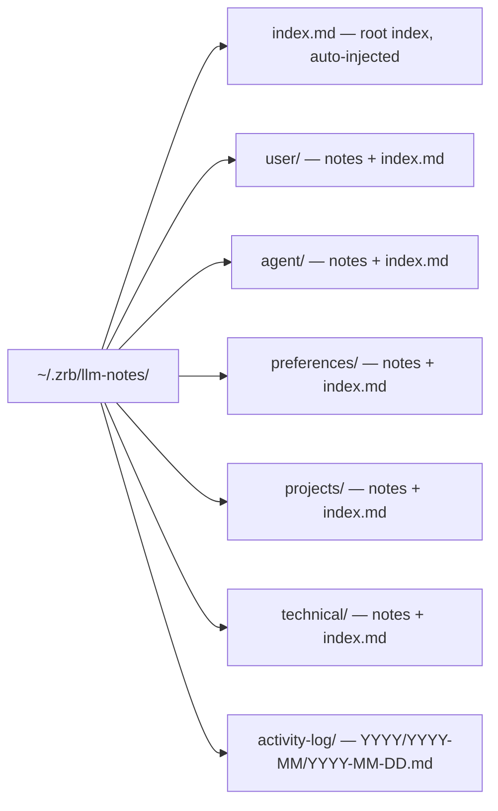

🔖 [Documentation Home](../README.md) > [Technical Specs](./llm-context.md)

# LLM Journal System (Technical Specification)

Zrb provides a directory-based journal system for maintaining persistent context across LLM sessions. This allows the assistant to remember project-specific details, user preferences, and local environment information through a hierarchical file system structure.

---

## Table of Contents

- [Overview](#1-overview)
- [Storage Mechanism](#2-storage-mechanism)
- [Prompt Injection](#3-prompt-injection)
- [Automatic Creation](#4-automatic-creation)
- [Configuration Placeholders](#5-configuration-placeholders)
- [Documentation Separation](#6-documentation-separation)

---

## 1. Overview

The journal is a directory of Markdown files organized hierarchically by topic or project, giving the assistant a structured place to keep context that outlives a single session.

| Property | Value |
|----------|-------|
| Storage | Directory of Markdown files |
| Organization | Five note categories plus a dated activity log |
| Entry point | The root index file — `ZRB_LLM_JOURNAL_INDEX_FILE`, `index.md` by default — the only file injected into a session |
| Written by | `LogActivity`, `WriteDayHandover`, `WriteJournalNote`, `SupersedeJournalNote` and `DeleteJournalNote`, which own the on-disk format |

---

## 2. Storage Mechanism

Journal entries are stored in a directory structure with a central index file.

Every journal knob (directory, index file, injection cap, HUD cap, first-turn auto-search, git backing) is listed in [LLM Configuration → Journal & Context Storage](../configuration/llm-context.md#journal--context-storage); the directory defaults to `~/.zrb/llm-notes/` and every index to `index.md`. The `~/.zrb/` path and the `ZRB_` prefix are the stock build's: a white-labeled build reads its own `<PREFIX>_LLM_JOURNAL_…` variables and puts the directory under its root group name (`~/.<ROOT_GROUP_NAME>/llm-notes/`).

`ZRB_LLM_JOURNAL_ENABLED=false` turns the whole subsystem off. There is no journal prompt section to suppress — the journal *is* its six tools (`SearchJournal`, `LogActivity`, `WriteDayHandover`, `WriteJournalNote`, `SupersedeJournalNote`, `DeleteJournalNote`), so the flag drops them from the per-run tool factories in `common_tools.py`, and `render_journal_index` checks the same flag for the `<journal-index>` injection. The model is then never told a journal exists (ADR-0055).

`ZRB_LLM_JOURNAL_DIR` is **not** an off switch: clearing it falls back to `~/.zrb/llm-notes/` rather than disabling journaling.

### Directory Organization

The writers create a fixed layout (`ensure_journal_tree` in `src/zrb/llm/tool/journal_write.py`): five note categories and an activity log, each with its own index. The layout below shows the default `index.md`; every index carries the configured `ZRB_LLM_JOURNAL_INDEX_FILE` name instead when you set one.



`WriteJournalNote` writes `<category>/<slug>.md`, with `slug`, `applies_when` (required) and `status` (`active`, or `superseded` once retired) in its frontmatter; a slug that is not kebab-case is refused. `applies_when` is the condition under which the note still holds, in a form a later session can check — a version, a file, a setting, a stated preference — and a write without one is refused with a `[SYSTEM SUGGESTION]`, as is the `not stated` placeholder an earlier version stored (old notes carrying it still load). `hud_line` is required: it is the one line the injected index shows, so the caller writes the claim rather than the code deriving it from the Finding, and a write with an empty one is refused (the refusal quotes the line the note already carries when there is one). A line over 160 characters is cut at a word boundary and ends in an ellipsis rather than being refused — the line is what a later session reads the note by, so refusing used to trade the whole note for a handful of characters, and the mark is what keeps a cut from reading as a claim that simply stopped. `keywords` is an optional comma-separated, lower-case list, derived from the slug and title when a write names none. A write also answers with the notes it **sits beside** — the three nearest by shared title, keyword and name words, scored with the same word extraction the claims block ranks by, a retired note excluded — because the note a finding contradicts is usually one the writer never opened; naming them is what lets a contradiction be revised in the same turn instead of waiting for someone to notice that two notes disagree. `SupersedeJournalNote` retires a note whose `applies_when` no longer holds: the file stays, its `status` becomes `superseded`, `superseded_by: <category>/<slug>` records the note that replaced it when one did (refused if that note is not on disk), and its line leaves the root index. `DeleteJournalNote` removes a note, every link to it, and any other note's `superseded_by` naming it. `LogActivity` appends to the day file under `activity-log/`, with an optional `· imp N` ranking key and an optional `· project:<tag>` grouping key. `WriteDayHandover` writes that same day file's `## Handover` section — the one the first turn of a session reads first — replacing any handover already there rather than adding a second, and placing it under the day's lines and above its `## Open` list. With `ZRB_LLM_JOURNAL_GIT_ENABLED` on (the default) and `git` installed, the journal root is also a git repository and each write, supersede or delete is a commit; `journal_transaction` batches many changes from Python under one lock and one commit.

### Note Scope

A note may carry `repo: <tag>` in its frontmatter, saying which repository it is about. The injected index shows a note in full when its tag is empty or matches the repository in hand; the notes of the other repositories are compressed to one line each, under `## Other projects`, naming how many there are and quoting the newest claim. `SearchJournal` is never filtered.

Compressing rather than hiding is the point. Working in one repository must not mean forgetting the others — a session that cannot see the bank pipeline any more will re-plan work that already exists. One line per repository is enough to know the work is there and what it is about, and the detail stays one search away.

`WriteJournalNote` takes `repo` and defaults it by category: a `projects` or `technical` note takes the repository it was written in, while `user`, `preferences` and `agent` stay untagged and travel with the person. Passing `global` as the argument is how a work-scoped note opts out, and the file then carries no `repo:` line at all — the reserved word lives in the argument, never in the frontmatter, so a repository that is really called `global` is a tag like any other. A note with no tag at all is shown everywhere — the field is new, and a default that guessed would hide the whole journal at once.

The tag is the repository's directory name, read with `git rev-parse --git-common-dir`, so every worktree of one repository answers with the repository rather than a branch name. A submodule's common directory is `<super>/.git/modules/<name>`, which *is* the repository: only a directory literally named `.git` is a container, and only its parent names the repository. Outside any checkout nothing is filtered, because there is nothing to compare a tag against.

A revision without a `repo` argument keeps the tag the note already has. A note is corrected from wherever the reader happens to be, and re-deriving the scope from that would move a note about one repository into another for having been fixed there; only a new note takes the repository in hand, and an explicit argument still moves it.

The digest sits outside the index cap, beside the wrapper rather than inside the index: the cap ranks lines it recognises and would drop an unknown section first — exactly the amnesia the section exists to prevent.

The per-turn claims take the same rule as the index, because a scope that means one thing in the index and another a turn later is not a scope. The first-message auto-search is the exception: it is driven by the user's own words, and a message that names another project has to reach that project's notes.

Measured on the real journal (317 notes, every work-scoped note stamped `zrb`, `ZRB_LLM_JOURNAL_INDEX_MAX_CHARS` at 3,600):

| view | injected block | note lines | work-scoped lines |
|---|---|---|---|
| working in `zrb` | 4,139 chars | 17 | 9 |
| working in another repository | 4,352 chars | 18 | 2 |

The 213 characters the second view pays are the `## Other projects` heading and one line: `- zrb — 167 notes, newest (2026-11-03): …`. What changed is what fills the index — nine lines of another repository's detail became one line saying the work exists.

### Expiry

`applies_when` is required at write, but almost every value is prose, and nothing can check a sentence — so a note that stopped holding arrives every turn until somebody notices. Four forms are checked against this machine, without asking anyone:

| form | holds while | checked by |
|---|---|---|
| `file:<path>@<sha>` | the file's content still hashes to `<sha>` | `journal_expiry.file_sha`, `SHA_LENGTH=12` |
| `version:>=3.29` | zrb's own version satisfies the comparison | `importlib.metadata.version("zrb")` |
| `setting:<NAME>=<value>` | `CFG.<NAME>` reads as that token | `getattr(CFG, name)`, `on`/`off` folded to `true`/`false` |
| `date:<YYYY-MM-DD>` | today is on or before that day | `date.today()` |

A `file:` path is relative to the repository root and the digest is stamped **at write time** (`_write_note_locked`), because a condition nobody stamped is a condition nobody can evaluate. It is answered only in the repository it was stamped in and only when the note carries that repository's tag: the same relative path in another checkout is another file, and a mismatch there would report a live note as false.

Everything else is prose, and prose never expires — guessing that a sentence is false would retire a note its author still believes. The same rule covers a condition this machine cannot read: a missing file is a change, an unreadable one (`""` from `file_sha`) is not, and a version this build cannot parse or a setting it does not carry answer "cannot tell".

Expiry **hides, it does not retire**. A note known to be disproved stops being injected — the index lines the writer owns for it, its per-turn claims, and its place as the newest claim in `## Other projects` — while the file, its `status`, `SearchJournal` and the category indexes are untouched. Superseding stays the act that retires a note by hand, and `DeleteJournalNote` the act that removes it.

Measured on the real journal 2026-11-03: **318 notes, 0 with a checkable condition, 0 expired**. The mechanism costs one `list_notes` it already had plus one hash per `file:` note; it starts paying the turn a note names something checkable.

### Index File Structure

The root index is created with this skeleton, and every note's one-line summary is rendered under the HUD section its category and pin decide: `User` (`user` and `preferences`), `Constraints` (a pinned `projects` or `technical` note), `Agent` (`agent`), or `Recent` (an unpinned `projects` or `technical` note). `agent` holds what is true of the assistant itself — standing choices, working style, how it wants to be treated — and `preferences` holds what the user stated about how *they* want to be worked with, so a fact about the agent never lands in the user's section by default:

```markdown
# Journal

## User

## Constraints

## Agent

## Recent

## Directories

- [user](user/index.md) · [agent](agent/index.md) · [preferences](preferences/index.md) · [projects](projects/index.md) · [technical](technical/index.md) · [activity-log](activity-log/index.md)

## Recent Insights
```

### The Indexes Are Rendered From the Notes

A note's frontmatter is the one source of truth for what the indexes say about it: `status`, `applies_when` (required), `hud_line` (required, and the summary the index shows), `pinned`, `keywords`, and `updated` (when the note was last written, which is the order the section cap evicts by), plus `superseded_by` once another note replaced it. The root index and every category index are a view rendered from those fields (`journal_index.py`; the note value and its frontmatter are in `journal_note.py`). A write, supersede, delete or refile changes the note and renders again, and rendering the same notes twice yields the same bytes.

What the render produces: the four HUD sections in a fixed order, each listing its lines newest `updated` first and held to `ZRB_LLM_JOURNAL_HUD_MAX_ENTRIES_PER_SECTION` where unpinned lines allow (the oldest unpinned line goes first, a pinned line only when every line in the section is pinned, so a section with more pinned lines than the cap stays above it; `WriteJournalNote` names what its write evicted); `## Recent Insights`, which lists the newest `ZRB_LLM_JOURNAL_CATALOG_MAX_ENTRIES` active notes (newest first, `<= 0` for all) followed by one `- _N older notes: see each category's index_` line when any are cut; a link to each category in `## Directories`; and a category index that lists every note in it, superseded ones included. The cap is a view: an evicted note keeps its `hud_line`, so raising the cap brings its line back.

**Foreign lines.** A line in a generated region that no note accounts for is a hand edit, and the render carries it through unchanged and in place, never evicts it, and does not count it toward the cap. Ownership is read from the note link a line already carries, so no marker is added to the injected text and no state is kept beside the index. A HUD line (a bullet, an optional pin marker, the text, then a trailing note link to the note's file) belongs to the note that link names, provided that note has a `hud_line`; a `## Recent Insights` or category-index line (a bullet holding one titled link) belongs to the note whose file it links, and the catalog's `older notes` line belongs to the renderer; every other line is foreign.

The failure modes follow from that rule. A hand edit to the text of a line a note owns is reverted at the next render, because the text is the note's `hud_line` — edit the note's frontmatter, or call `WriteJournalNote`. A hand-written line that ends in a note link to a note that has a line is claimed by that note, and a hand-written bullet that is only a link to a note, in a catalog or category index, is relabelled. A note whose title or `hud_line` is edited in its file keeps its old index line only if the link no longer matches; otherwise the next render replaces it. A line that is nothing but a link to a note is dropped when that note is deleted, a hand-written one included, because it would otherwise be a broken link. Anything else a person writes in the index — a heading, a paragraph, a bullet with no note link — is never touched.

**Older journals.** A journal written before the index was derived held each pin and HUD line only in the index text. The first journal call reads the first line that links a note without an `updated` stamp into that note's frontmatter (`hud_line`, `pinned`, and an `updated` stamp that keeps the line order), then renders; a line that no note accounts for stays where it was as a foreign line. A note is migrated once, so running it again changes nothing.

---

## 3. Prompt Injection

The root-index snapshot is deliberately kept **out of** the cached system prompt (`src/zrb/llm/prompt/live_context.py::render_journal_index`). Embedding the mutable index in the cached prefix would invalidate that cache every time the agent journaled mid-session (ADR-0042), so instead it travels through the conversation itself, as part of the `<live-context>` block appended to the latest **user** message — never the system prompt.

The index is only injected at the two moments it could otherwise be missing from context:

- **The first turn** — when history is still empty, `render_live_context(..., inject_journal_index=True)` appends the snapshot.
- **History summarization** — `summarize_history` re-seeds the index into the freshly-compressed history so it survives compaction.

On every other turn the `<journal-index>` block is omitted — the agent is expected to already have it from earlier in the conversation — and a much smaller `<journal-claims>` block takes its place (see §3.1).

When present, the block is wrapped as its own tag inside the live-context payload (shown with the default index name — the header and the category hint both carry whatever `ZRB_LLM_JOURNAL_INDEX_FILE` says):

```
<journal-index>
Your persistent memory (index file: /abs/path/to/index.md). Use SearchJournal for full entries; a category's index.md (e.g. technical/index.md) lists every note ever written in it, uncapped. Change the journal only through LogActivity, WriteJournalNote, or DeleteJournalNote — and retire a note that stopped applying with SupersedeJournalNote ...
[content of the root index, capped at ZRB_LLM_JOURNAL_INDEX_MAX_CHARS]
[on the first turn, notes possibly related to the opening message, when ZRB_LLM_JOURNAL_AUTO_SEARCH_ENABLED is on]
</journal-index>
```

The header carries the **absolute path** of the index file, so the agent can `Read` the file directly when it needs more than the cap allows. The `SearchJournal` directive stays — searching is the intended interface for content, not dumping the whole file into context.

When the content exceeds the cap it is cut **on a line boundary** and ` (...more)` is appended, and the block marks the truncation:

```
Your persistent memory (index file: /abs/path/to/index.md). Truncated at `(...more)`. Use SearchJournal for full entries; ...
```

Cutting on a line boundary matters because the entries are facts about the user — half a sentence is worse than none. What the cap keeps is **ranked, not sliced** (`src/zrb/llm/prompt/journal_core.py`, ADR-0136): pinned lines first wherever they sit, then claims (the unpinned HUD lines, each ending in a link to its own note), then the `## Directories` pointer, then everything else. The sections take turns within a rank, so a section holding twice the lines does not take twice the cap. A head-first slice cannot do that: it cannot see a section boundary, so one long section can spend the whole cap and the pinned lines further down never reach the model. A `## Recent Insights` title is dropped only once the claim for the same note is actually in the block, since the block would otherwise state one fact twice, the second time in the weaker form — but a claim too long to fit leaves the short title as the note's only trace. The index is read with the writer's own parser and predicates, and a line is kept only when the text re-rendered with it still fits, so the cap is measured on the emitted block rather than predicted by a second copy of the layout arithmetic.

The overflow note names the **sections** that lost lines, ordered by the best line each lost and then by how many, and counts any pinned line that did not fit; it is charged to the same cap as the content, because a cap that exempts what stands in for what it dropped is not a cap. The content stops a quarter of the cap short so the note has room, and the note takes whatever the content could not use: under a cap too small for the sentence it degrades to a bare `(...more)`, and under a cap that keeps no line of the index — or cannot hold even the marker — no block is injected at all, because a truncated index that does not say it is truncated reads as the whole index.

Within a section the lines are rendered newest first, and unpinned lines are evicted first, oldest first, down to `ZRB_LLM_JOURNAL_HUD_MAX_ENTRIES_PER_SECTION`. A pinned line is evicted only when every line in its section is pinned, and then the oldest pinned lines go until the cap holds. A section with more pinned lines than the cap that still has unpinned lines loses all of them and stays above the cap.

Nothing is injected at all when the index file is missing, unreadable, or empty; when `ZRB_LLM_JOURNAL_INDEX_MAX_CHARS` is `0`; or when `ZRB_LLM_JOURNAL_ENABLED` is `false`. A missing block therefore does not prove an empty journal — and nothing tells the model so. Stating the caveat would cost either prompt weight or a tool docstring paid for on every request, so it is a known gap rather than shipped text (`render_journal_index`'s docstring records it). It matters only when `ZRB_LLM_JOURNAL_INDEX_MAX_CHARS` is `0` while the journal tools stay registered — a deliberate and unusual pairing.

### 3.1 The mid-session claims

The index goes in once, so a note written after it is invisible until the conversation is compacted: the session can record a fact and then answer as though it had never recorded it. Each turn after the first therefore carries at most `ZRB_LLM_JOURNAL_CLAIMS_PER_TURN` claims (default **3**) inside `ZRB_LLM_JOURNAL_CLAIMS_MAX_CHARS` (default **1000**):

```
<journal-claims>
Journal claims from notes written since this session's index went in. Each is what its note says in one line; read the note before relying on the detail.
- 📌 Retry is not concurrency-safe. ([note](technical/retry-policy.md))
</journal-claims>
```

The claim is the note's `hud_line` — why that line is a required argument of every write — rendered by the same `hud_line_of` the index uses, so a claim looks the same in both places.

Ranking (`src/zrb/llm/prompt/journal_claims.py`) multiplies three things: **freshness** (half-life one day — the notes a session has not been shown are the ones written during it, and `SearchJournal` is what finds last week's), a **pin** (`× (1 + 2)` — a pinned claim is a constraint that has to keep holding, so one written this session must reach the next turn), and the **words a claim shares with the turn** (`× (1 + shared)`), so among notes written together the ones on the subject take the few slots. Only notes written or revised **during this session** are candidates: the session's first event (a prompt) is the anchor, and anything older is what `SearchJournal` and the category indexes are for — including a note the index's cap kept out. A superseded note is never a claim: it is evidence, not memory. A claim whose line does not fit the character budget is skipped rather than ending the turn, and it stays eligible on a later turn.

Which claims a session already carries is read back from the `injected` events in `journal-usage-YYYY-MM.jsonl`, not kept in memory: the web runner builds every message in a fresh process, and a set that reset would re-inject the same claims for the life of the conversation. **A note counts as shown only as it stood when it was injected** — every event carries a timestamp, and a note whose `updated` stamp is later than the injection that carried it is eligible again, so a correction made mid-session reaches the next turn. Comparing names alone hides every revision, which is the claim a session most needs. Each claims block records its own `injected` event, so the cost stays visible in `/usage`, and an unreadable or unwritable log fails open: a repeated claim costs a few tokens while failing closed would drop the memory the log exists to carry. For that case the process also remembers what it showed, per conversation and per version, so a read-only home does not turn the block into the same three claims every turn.

The first turn still injects the whole index: ranking that snapshot as well is a separate change, since it decides which of the index's own sections survive the cap.

### 3.2 The day block

The index is knowledge; the day block is memory of a time. It is rendered beside the index on the first turn (`render_day_block`), capped at 1,900 characters, and it carries three sections in this order:

| Section | What it holds | Why in this position |
|---|---|---|
| `## From the last me, to the next me` | the newest `## Handover` from today or yesterday | the one part of a day file no later reader can reconstruct, so it leads |
| `## This week` | one line per day of the previous six: `- 2026-11-02 — soda: …` | a day is recognised by what it was mostly about, and that is what the week is for |
| `## Today` | the day's five highest-ranked lines | detail, and the section the cap cuts first |

A week line names the day's **dominant project** — the group most of its lines carry — and then that project's highest-ranked line, shortened to 72 characters. Rank alone would be wrong: measured on 2026-11-02, a day spent on one project from morning until noon had its highest-ranked line at 22:45 in another one. `LogActivity(project=...)` writes the `· project:<tag>` a line is grouped by, normalized to one token; a line without one still reaches the week, under no label, and a journal written before the field existed renders the same way.

Today's lines and the week's carry no ranking keys: `· imp N` orders lines and `· project:x` groups them, and neither says anything to the reader. Sections are fitted in order against the cap, each keeping room for its heading and one line, so a long handover cannot push the week out and the week cannot push today out entirely.

---

## 4. Automatic Creation

`search_journal` (`src/zrb/llm/tool/journal.py`, exposed to the agent as `SearchJournal`) reads a plain multi-word query as any-of its significant words and ranks a file holding more of them first: notes whose title matches, then other notes, then the indexes and the activity log; a query with regex metacharacters is a regex, and a zero-hit search suggests note titles sharing a word with the query under `did_you_mean`. It calls `os.makedirs(..., exist_ok=True)` when the configured directory is absent and reports the same empty result an unmatched search returns.

That behaviour is deliberate. Reporting a missing directory as an error made the whole memory layer read as unavailable, and the agent responded by declaring it could not journal rather than by writing its first note. An unwritten journal is *empty*, not broken.

**The rest of the tree is created by the writers, not by the agent.** `LogActivity` and `WriteJournalNote` (`src/zrb/llm/tool/journal_write.py`) derive every path and timestamp themselves, create the root index and the six directory indexes (five categories plus `activity-log`) on first write, and maintain the link graph — every index rendered from the notes, each forward link matched by a reciprocal backlink. The agent supplies content; the structure is code (ADR-0055).

---

## 5. Configuration Placeholders

The journal system uses configuration placeholders that are automatically replaced in prompts:

| Placeholder | Replaced With |
|-------------|---------------|
| `{CFG_LLM_JOURNAL_DIR}` | Journal directory path |
| `{CFG_LLM_JOURNAL_INDEX_FILE}` | Index filename |
| `{CFG_ROOT_GROUP_NAME}` | Root group name (e.g., "zrb") |
| `{CFG_LLM_ASSISTANT_NAME}` | Assistant name |
| `{CFG_ENV_PREFIX}` | Environment variable prefix |

---

## 6. Documentation Separation

| Location | Content Type |
|----------|-------------|
| `AGENTS.md` | Technical documentation (architecture, conventions, patterns) |
| Journal | Non-technical notes, reflections, project context |

> 💡 **Best Practice:** Use `AGENTS.md` for rules the LLM must follow. Use the journal for information the LLM should remember.

🔖 [Documentation Home](../README.md) > [Technical Specs](./llm-context.md)
