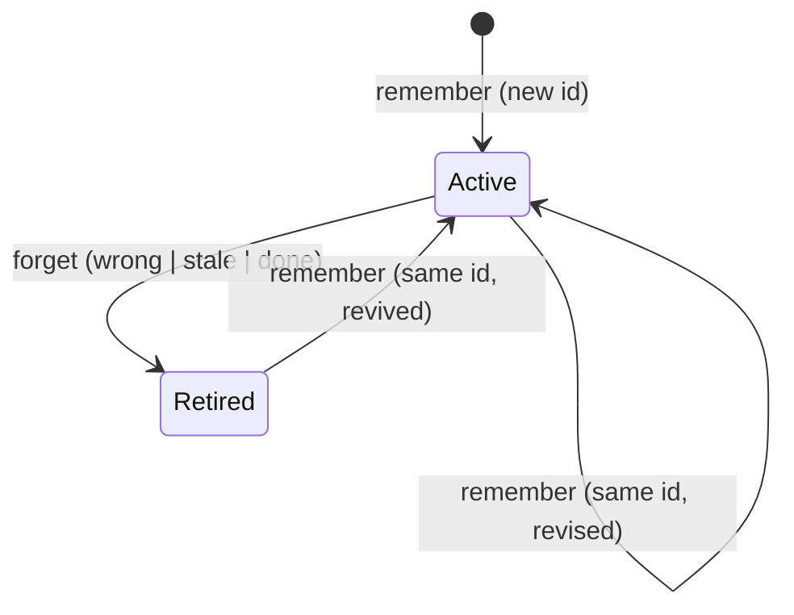

🔖 [Documentation Home](../README.md) > [Technical Specs](./llm-memory.md)

# LLM Memory (Technical Specification)

**Status: accepted and implemented.** The code lives in `src/zrb/llm/memory/` with its tools in `src/zrb/llm/tool/memory.py`; §11 records the six places where building it changed this document. It replaced the journal system, whose code was deleted in 3.33.0. What outlives it is the notes directory: an existing `~/.zrb/llm-notes` is read into the store once, and [the notes layout](./llm-context.md) is documented for that reason.

A persistent memory for the agent: what it knows about the user, about the work, and about itself, carried from one session to the next. The design is built on one rule:

> **Retrieval is four fixed layers. Writing is two verbs.**

Everything lives inside those six slots — including the diary, which is a `remember` kind rather than a fourth tool. Everything that could not be placed in one of them was cut (see §10).

---

## Table of Contents

- [1. Principles](#1-principles)
- [2. Folder Structure](#2-folder-structure)
- [3. File Formats](#3-file-formats)
- [4. Retrieval](#4-retrieval)
- [5. Writing](#5-writing)
- [6. The Reviewer](#6-the-reviewer)
- [7. Mechanics](#7-mechanics)
- [8. Configuration](#8-configuration)
- [9. Migration and Non-Goals](#9-migration-and-non-goals)
- [10. What Was Deliberately Cut](#10-what-was-deliberately-cut)

---

## 1. Principles

1. **Two authors.** The human owns the persona. The agent owns the facts. No tool writes a prompt file; no prompt file is a memory note.
2. **A claim is a file.** One sentence per file, one file per subject. A fact can be cited, revised, retired, and read alone; nothing is entangled with anything else.
3. **The bounded core is the only thing always in context.** Everything else is unreachable except through search. Growth costs nothing per turn.
4. **The cap is enforced by refusal, not by summarization.** A write that cannot fit fails with the exact deficit and the current core, so consolidation happens in that turn.
5. **Retire, never delete.** A wrong belief keeps its file with a reason. "What did I believe, and why did I stop" stays answerable.
6. **The day is written, not inferred.** A diary entry states what the day was; the week view reads those statements instead of deriving themes from tag counts.
7. **Git is the audit log and the undo button.** Every write commits, naming its own files so work the human had staged stays staged. The repository is the store's own or the notes directory itself; a checkout that merely contains the notes gets no memory commits.

---

## 2. Folder Structure

```
${LLM_MEMORY_DIR}                 default: ${LLM_NOTES_DIR}/memory-v1 — ~/.zrb/llm-notes/memory-v1/
├── core.md                       GENERATED. Injected. Never hand-edited.
├── facts/
│   ├── staging-ssh-port.md       one claim per file
│   ├── rotate-staging-cert.md    a loop is a fact with kind: loop
│   └── gofrendi-prefers-diagrams.md
├── diary/
│   └── 2026-11-03.md             one entry per day, first person
├── log/
│   └── 2026-11-03.md             append-only, one file per day
├── .lock                         serialises write transactions (gitignored)
└── .git/                         one commit per write
```

Four kinds of file and a lock. There are no category directories, no per-category indexes, and no backlink files — Obsidian computes backlinks from `[[links]]` itself.

Each kind has one cadence, and that is why the count stays at four:

| File | Answers | Written | Rewritten? |
|---|---|---|---|
| `log/` | *what happened*, with clock times | many appends a day, one file per day | never |
| `diary/` | *what the day was*, in the first person | once a day, revised as it goes | merged, never truncated |
| `facts/` | what is true, undated | occasionally | replaced by subject |
| `core.md` | what must never be forgotten | generated on a pin or loop change | regenerated |

Events → days → beliefs → essentials: minutes, hours, indefinite, always.

| Path | Read by | Written by |
|---|---|---|
| `facts/*.md` | renderer, search, reviewer, human | `remember` / `forget` |
| `diary/*.md` | recent block, week view, search, human | `remember` / `forget` |
| `log/*.md` | recent block, search, human | reviewer (append), human |
| `core.md` | injection, human dashboard | renderer only |
| Persona (`{LLM_PROMPT_DIR}/persona.md`) | system prompt, slot 1 | **human only** — outside this tree |

The persona is not in the memory directory on purpose: it is a prompt section, it survives a profile switch, and nothing in this system can reach it. Identity proposals arrive as facts tagged `identity-proposal` and a human merges them.

**Why the diary is not a section of the log.** An append-only stream and a rewritten section in one file collide. The journal's day file documented the result: a handover owned everything from its heading to the next one, so a day line placed past it was deleted by the next handover rewrite, and four pieces of code — an append helper, a handover stripper, an insert-after-entries step and a "recovered from a handover" marker — existed only to stop one shape from eating the other. Splitting the two files deletes that entire class of bug: `log/` is only appended, `diary/` is only rewritten, and neither can consume the other's content.

---

## 3. File Formats

### 3.1 A fact — `facts/<id>.md`

```markdown
---
id: staging-ssh-port
claim: Staging SSH is port 2222, key ~/.ssh/staging_ed25519 — not 22.
kind: fact
status: active
pin: true
tags: staging, deploy, ssh
applies_when: until hosts/staging.yml changes
source: session 2026-11-03
updated: 2026-11-03T18:41:07
---
Port 22 on that host is the gateway. Found when deploy failed with connection
refused. Related: [[deploy-pipeline]]
```

| Field | Required | Values | Meaning |
|---|---|---|---|
| `id` | yes | kebab-case, ≤ 64 chars | The subject. Same subject ⇒ same file. This *is* deduplication. |
| `claim` | yes | one sentence, ≤ 160 chars | The canonical sentence: rendered in the core, matched by search, compared on revision. |
| `kind` | yes | `fact` \| `loop` \| `diary` | `loop` renders in its own section and closes with `forget`; `diary` has its own shape (§3.3) and its own directory. |
| `status` | yes | `active` \| `retired` | Only `active` renders and, by default, only `active` is searched. |
| `pin` | no | `true` \| `false` | `true` ⇒ the claim is rendered into `core.md`. Ignored for `loop`; **refused** for `diary`. |
| `tags` | no | comma list | Free vocabulary, searchable, zero code. This is where `person`, `lesson`, `identity-proposal` live. |
| `applies_when` | no | prose | When the claim stops being true. Prose, never evaluated — see §10. |
| `source` | no | `session <date>` \| `user` \| `observed` \| `migrated` | Where it came from. The basis for "you told me" vs "I inferred". |
| `updated` | yes | ISO datetime | Ordering and the session-delta comparison. |
| `reason` | retired only | `wrong` \| `stale` \| `done` | Why it was retired. |
| `retired_on` | retired only | ISO date | When. |

The body is evidence: context, quotes, links. It is never injected and never required. `[[other-id]]` links create the Obsidian graph.

### 3.2 A loop — `facts/<id>.md` with `kind: loop`

```markdown
---
id: rotate-staging-cert
claim: I owe a staging cert rotation, blocked on DNS access.
kind: loop
status: active
tags: staging
source: session 2026-11-03
updated: 2026-11-03T19:02:11
---
Asked gofrendi for credentials; not yet provided.
```

A loop is not a new concept or a new file: it is a fact whose lifecycle is visible, so closing it with `reason: done` is the same mechanism as retiring a stale claim with `reason: stale`.

### 3.3 A diary entry — `diary/<YYYY-MM-DD>.md` with `kind: diary`

```markdown
---
id: 2026-11-03
kind: diary
status: active
claim: Spent the day on memory design; cut confidence and identity from the spec.
handover: Deploy still blocked on the staging cert — ask for DNS access before anything else.
source: session 2026-11-03
updated: 2026-11-03T21:10:44
---
Long day of arguing with myself about memory. The useful move was dropping things
rather than adding them: confidence, identity, the expiry engine. Each looked like
rigor and was actually a field nobody would fill.

What I notice about how gofrendi works: he probes a design by asking what it
costs, not what it enables.

Open question I did not settle: whether the injected block belongs on the first
turn only.
```

| Field | Required | Rule |
|---|---|---|
| `id` | yes | An ISO date, `YYYY-MM-DD`. The date *is* the identity: one entry per day, deduplicated by construction. |
| `claim` | yes | The day in one line, ≤ 160 chars. This is what the week view shows, so the week stops being inferred. |
| `handover` | no | The note to the next session, ≤ `LLM_MEMORY_HANDOVER_MAX_CHARS` (700), refused above it. It is the day file's `## Handover` section, moved into the entry where it can be rewritten without touching an append-only file. Replaced, never appended: it is the state of play, and two of them are not one. |
| `body` | no | First person, past tense, ≤ `LLM_MEMORY_DIARY_MAX_CHARS` (2,000), refused above it. A diary is a page, not a transcript — the log holds the detail. `body_mode="a"` adds this paragraph after the stored one instead of replacing it, and is measured against the cap as the whole it becomes. |
| `pin` | — | Refused for `kind: diary`. A diary entry never enters the core. |
| `status` | yes | Always `active`; only `forget(reason="wrong")` can retire it. `stale` and `done` are refused, because a day does not stop being true. |

A second session on the same day `remember`s into the same file and merges — which is what adding to a diary is. Omitted fields keep their stored values, so a session that only appends a paragraph cannot wipe the handover. `body_mode="a"` is how that paragraph is added without reading the day back: the join happens inside the store's lock, one blank line apart, because only the lock knows what the day already says.

### 3.4 The core — `core.md` (generated)

```markdown
<!-- GENERATED from pinned facts and open loops. Edit facts/<id>.md, never this file. -->
## Always
- Staging SSH is port 2222, key ~/.ssh/staging_ed25519 — not 22. [staging-ssh-port]
- gofrendi wants diagrams over prose for architecture. [gofrendi-prefers-diagrams]

## Open loops
- I owe a staging cert rotation, blocked on DNS access. [rotate-staging-cert]
```

Rules:

- Pinned facts render **alphabetically by id** — a stable block is a cacheable block, and it does not churn when an unrelated fact is revised.
- Open loops render **newest first** — recency is what makes an open thread feel open.
- **Diary entries never render here.** The renderer selects `kind: fact` and `kind: loop` only.
- An empty section is omitted entirely. An empty core is an empty file, not an error.
- The comment line is stripped before injection and excluded from the cap.

### 3.5 The log — `log/YYYY-MM-DD.md`

```markdown
# 2026-11-03
- 18:41 — Fixed WSL ACL denial on the UNC workspace path. (zrb)
- 19:02 — gofrendi asked what the design costs, not what it enables. (zrb, meta)
```

Append-only. One line per event, newest at the bottom, one file per day. Format:

```
- HH:MM — <text>. (<tags>)
```

The date is the filename, not a field: a day file cannot hold a line from another day, and the renderer prefixes `MM-DD` only when it lifts a line from a day other than today.

The log is *events only*. There is no `## Handover` section and no `[handover]` marker: state of play lives in the diary's `handover` field, where it can be rewritten without touching an append-only file.

**Ephemeral detail, permanent narrative.** A log day may be pruned (`LLM_MEMORY_LOG_RETENTION_DAYS`); that day's diary entry may not. The asymmetry is the reason for the split — the diary is what the log was for, so a store that kept only the diary would still be a store with a past. Retention is **off by default**: deleting a log day is the one destructive operation the store has, so it is opted into rather than inherited. Facts and diaries are never deleted; only logs are.

### 3.6 Git

`git init` on first write; `.gitignore` contains `.lock`. One commit per write, message `remember: <id>`, `forget: <id>`, `log: <YYYY-MM-DD>`, `diary: <YYYY-MM-DD>`. Commits use inline `-c user.name=zrb-memory` so no global identity is needed.

---

## 4. Retrieval

### 4.1 The four layers

| # | Layer | Source | Cap | When it is emitted |
|---|---|---|---|---|
| 1 | Identity | persona prompt section | ~800 chars | System prompt, every request. Never changes mid-session ⇒ cache-stable. |
| 2 | Core | `core.md` | 4,000 chars | First user turn of a conversation, and again after any history compaction. |
| 3 | Recent | newest `handover` + today's diary `claim` + last 4 log lines | 1,600 chars | Same moment as layer 2. |
| 4 | On demand | `search` | 10 hits | Whenever layers 1–3 do not answer. |

Standing cost: ≈ 6.6k characters, ≈ 1.7k tokens. Everything else in the store — every fact body, every diary body, every log line, every transcript — costs nothing until searched.

### 4.2 What the model sees at session start

```
<memory>
The store root — what a `facts/`, `diary/` or `log/` path is relative to — is the next line, verbatim:
/home/user/.zrb/llm-notes/memory-v1
Core: 3412 of 4000 characters (85%), 9 pinned claims and 12 open loops, nothing cut.

## Always
- Staging SSH is port 2222, key ~/.ssh/staging_ed25519 — not 22. [staging-ssh-port]
- gofrendi wants diagrams over prose for architecture. [gofrendi-prefers-diagrams]

## Open loops
- I owe a staging cert rotation, blocked on DNS access. [rotate-staging-cert]

## Recent
- Handover (2026-11-03): Deploy still blocked on the staging cert — ask for DNS access first.
- Today (2026-11-03): Spent the day on memory design; cut confidence and identity.
- 19:02 — gofrendi asked what the design costs, not what it enables. (zrb, meta)
- 18:41 — Fixed WSL ACL denial on the UNC workspace path. (zrb)
</memory>
```

The block opens with a contract saying its lines are data and where each claim's file is; the sample above omits it. Between that contract and the core sit the block's own two lines, both derived from the store rather than fixed text: the store's root — `facts/<id>.md`, and a `SearchMemory` result in any scope, are relative and a model told to "read that file" needs the directory — and the core's budget, because a claim the cap dropped leaves no trace and the refusal at write time was the only report of the cap. The budget line is absent when the core holds no claim. Both figures are the block's own moment: a pin later in the session moves them, and `Remember`'s reply reports the core as it then stands. The root is configuration rather than a claim, and it is read by the same model, so it takes the claim rule too: the path is written verbatim on its own line, with any line break folded to a space, so it can be handed to a tool as it stands — quoting or escaping it would make it a language the reader has to decode, and JSON escapes every backslash of a Windows path — and a path carrying an instruction marker is withheld, the way a claim that reads as an instruction is — checked on the collapsed line rather than the raw value, since a marker split by a line break is invisible before the collapse and whole again after it.

The block is appended to the **first user message**, not the system prompt: the core changes when the agent learns, and putting a mutable block in the cached prefix would invalidate that cache on every write.

### 4.3 Render algorithms

```
render_core(facts):
    pinned = active facts with kind == fact and pin
    loops  = active facts with kind == loop
    out    = ["## Always"] + [f"- {f.claim} [{f.id}]" for f in pinned sorted by id]
    if loops: out += ["", "## Open loops"] + [f"- {f.claim} [{f.id}]" for f in loops newest first]
    return "\n".join(out)          # deterministic: same facts ⇒ same bytes
```

```
render_recent(diary, log):
    handover = newest diary entry with a non-empty handover, within 7 days
    today    = today's diary entry claim, if one exists
    tail     = last 4 lines of today's log, then yesterday's if fewer than 4
    out      = [f"- Handover ({handover.date}): {handover.text}"] if handover
             + [f"- Today ({today.id}): {today.claim}"]           if today
             + [line if from_today else f"- {mmdd} {line}" for line in tail]
    return cut_to(out, 1600)       # whole lines only; half a fact is worse than none
```

```
render_week(entries, today_day, days=7):
    for day in the last 7 days, newest first:
        if entries[day] is active: line = f"- {day} — {entries[day].claim}"
    return lines
```

The authored claim is the only line: a day with no entry renders nothing, because a day cannot be inferred from its log lines. An authored `claim` beats a derived theme, which is why the diary exists.

All three are pure functions of files on disk. Rendering twice yields identical bytes, so the renderer writes only when the output changed.

The block's own two lines are derived the same way, and are the only place the model is told its address and its budget:

```
render_store_note(root):
    if injection_reason(root): return "The store's path is withheld: it reads as an instruction."
    return ("The store root — what a `facts/`, `diary/` or `log/` path is relative "
            "to — is the next line, verbatim:\n" + one_line(root))

core_budget(facts, cap):
    rendered = render_core(facts)
    kept     = cut_lines(rendered, cap).splitlines()
    return {chars: len(rendered), cap: cap,
            pinned: count of pinned facts, loops: count of open loops,
            cut: claims whose own line is not in kept}
```

`chars` is measured before the cap, so an overflowed core reports a figure above its cap — the deficit, not a truncated size. `cut` is the only statement that a claim was dropped: the block does not carry it, and the delta catches up at three lines a turn.

### 4.4 The session delta

The core is emitted once, so a fact learned at turn 4 is invisible at turn 5. Each later turn therefore carries a small diff:

```
<memory-delta>
- Staging SSH is port 2222 … [staging-ssh-port] (revised)
</memory-delta>
```

Rule: facts whose `updated` is later than the session's first turn, at most 3 lines and 400 chars, skipped when empty. This is the one piece that keeps a session from answering as though it had never recorded what it just recorded.

### 4.5 Search

```
search(query, scope="facts", limit=10)
```

Tokenisation: lowercase split on whitespace. Any-of matching. No regex, no stemming, no embeddings.

| Scope | Searches |
|---|---|
| `facts` (default) | active facts and loops: `id`, `claim`, `tags`, body |
| `diary` | diary entries: `id`, `claim`, body |
| `log` | every log line, across all day files |
| `sessions` | `~/.zrb/llm-history/*.json` transcripts (a tool because that directory is outside the sandbox's readable roots) |
| `retired` | retired facts and diary entries only — "what did I believe, and why did I stop" |
| `all` | `facts` + `diary` + `log` |

Scoring, then sort by score desc and `updated` desc:

| Match | Score |
|---|---|
| `query` equals `id` | 100 |
| each term in `claim` | +10 |
| each term in `tags` | +5 |
| each term in body | +1 |
| each term in a log line | +1 |

Results are **pointers, not payloads**:

```
staging-ssh-port — Staging SSH is port 2222, key ~/.ssh/staging_ed25519 — not 22.  [facts/staging-ssh-port.md] (2026-11-03, pinned)
2026-11-03       — Spent the day on memory design; cut confidence and identity.    [diary/2026-11-03.md] (2026-11-03)
```

The model reads a path when it needs the body. That keeps results small and unpollutable. Zero hits returns `did_you_mean` built from ids sharing a term with the query, then an empty result — never an error, because an unwritten memory is empty, not broken.

---

## 5. Writing

### 5.1 The tool surface

Three tools. Two of them write.

| Tool | Capability | Signature |
|---|---|---|
| `search` | `READ` | `search(query, scope="facts", limit=10)` |
| `remember` | `EDIT` | `remember(id, claim, kind="fact", pin=False, tags=None, applies_when=None, source=None, handover=None, body=None, body_mode=None)` |
| `forget` | `EDIT` | `forget(id, reason)` where `reason ∈ {wrong, stale, done}` |

There is no `read`, `log`, `handover`, `diary`, `supersede`, `delete`, `pin`, or `list` tool. Each is either already possible (`read`) or is a `remember` call with a different `kind` (diary, handover).

### 5.2 `remember`

```
remember(id, claim, kind="fact", pin=False, tags=None, applies_when=None,
         source=None, handover=None, body=None, body_mode=None):
    require kind in {fact, loop, diary}
    require one_sentence(claim, max=160)
    if kind == "diary":
        require iso_date(id); require pin is False
        require body_mode is None or body_mode in {"w", "a"}   # diary only
        require body_mode != "a" or body.strip()
        require body is None or len(body) <= DIARY_MAX
        require handover is None or len(handover) <= HANDOVER_MAX
        path = diary/<id>.md
    else:
        require kebab(id)
        require body_mode is None                              # a fact body replaces
        require body is None or len(body) <= 8000
        path = facts/<id>.md

    old    = read(path)                              # None when new
    fields = merge(old.fields, given)                # unspecified fields keep their old values
    body   = old.body + "\n\n" + body if body_mode == "a" else (body or old.body)
    require body_mode != "a" or len(body) <= DIARY_MAX         # the whole it becomes
    fields.status = "active"; fields.updated = now()
    core   = render_core(load_all() + this fact)     # computed BEFORE anything is written
    if len(core) > CORE_MAX:
        raise Refusal(deficit, current_core=read(core.md))    # nothing was written
    with lock():
        write_atomic(path, fields, body)
        write_atomic(core.md, core) if the rendered section changed
        git_commit(f"remember: {id}")
    return f"Remembered {id} ({len(core)}/{CORE_MAX} chars)"
```

The append join runs inside the lock, not before it: the day it is joining is the
store's to read, and a session that reads it itself pays for the whole body in
its own context to produce two lines — the cost this flag exists to remove. The
cap is then checked on the merged whole, so a short paragraph that would push a
long day over it is refused with the number it would become, rather than written
and discovered by whoever reads it next.

Five properties follow from computing the core before writing:

- **Dedup is by identity, not similarity.** One subject, one file; one day, one diary entry. No duplicate-detection code exists.
- **Revision is a merge.** Omitted fields are preserved, so a session that only appends a diary paragraph cannot silently drop the handover, and a reviewer that restates a claim cannot silently drop the pin.
- **Overflow is atomic.** When the core is full, *nothing* is written, and the refusal is actionable:

```
[SYSTEM SUGGESTION]: memory core is 3,940/4,000 chars; this pin adds 180, exceeding
by 120. Nothing was written. Re-send as one batch: unpin or shorten entries from
current_core below to free ≥120 chars, and add this one — the cap is checked only on
the batch result.
current_core: [ … ]
```

- **Pin changes re-render, other writes do not.** A fact nobody pins costs one file and no core bytes; a diary entry never costs core bytes at all.
- **One verb, four acts.** A fact, a loop, a diary entry, and a handover are the same call with different fields, so there is one validation path, one refusal vocabulary, and one commit rule.

### 5.3 `forget`

```
forget(id, reason):
    require reason in {wrong, stale, done}
    entry = read(facts/<id>.md) or read(diary/<id>.md)
    require entry exists
    if entry.kind == "diary": require reason == "wrong"     # a day does not go stale
    fields.status = "retired"; fields.reason = reason
    fields.retired_on = today(); fields.updated = now()
    with lock():
        write_atomic(path, fields)
        write_atomic(core.md, render_core(load_all()))      # it leaves the core
        git_commit(f"forget: {id} ({reason})")
```

The file stays. Retiring a claim never removes evidence, and `search(scope="retired")` is how the agent answers "I thought X — why did I stop thinking X?"

### 5.4 Lifecycle



Retirement is reversible by design: `remember` on a retired id sets `status: active` again, which is what "I was wrong about being wrong" looks like. A diary entry is `active` from creation and can be retired only with `reason: wrong`.

---

## 6. The Reviewer

This is where ~90% of writes come from. The foreground model writes memory only when the user asks it to or when a fact must be captured mid-session; everything else is distilled after the fact, off the critical path.

| Property | Value |
|---|---|
| Trigger | Every completed turn |
| Concurrency | Asynchronous, fire-and-forget; never delays the reply |
| Model | The main model by default, or a cheaper one |
| Tools | `search` only, at most 2 calls (it needs them to avoid duplicate ids) |
| Inputs | The turn's transcript, the current core, today's diary entry, the last 20 log lines, the persona |
| Effect | Appends a log line; optionally remembers, forgets, writes today's diary, or revises its handover |

Its output is a JSON object, validated through the same code paths as the tools, so a reviewer write and a foreground write cannot diverge:

```json
{
  "log": "one line, or null",
  "remember": [{"id": "…", "claim": "…", "kind": "fact", "pin": false, "tags": "…"}],
  "forget": [{"id": "…", "reason": "done"}],
  "diary": {"claim": "…", "handover": "…", "body": "…"}
}
```

`diary.id` is implied: the reviewer's day. The entry is created if today has none and merged if it does.

Validation rules, in order:

1. **Search before add.** If a fact for the subject exists, the reviewer must revise that id rather than invent a second one.
2. **Never state what the turn did not establish.** A claim needs a source: the user's words, an observed result, or a file path. Guesses do not get written.
3. **Nothing durable ⇒ empty object.** "No memory change" is the normal outcome of most turns, and must be cheap.
4. **The diary is written for a day, not a turn.** It is revised when the day's narrative actually moved, not once per turn, or it becomes a second log — and a paragraph written later in the day is *appended* (`body_mode="a"`) rather than restated, because a writer that never read the day cannot faithfully rewrite it.
5. **Identity proposals are facts, not edits.** A pattern in how the user works goes to `tags: identity-proposal` with quoted evidence in the body. A human merges it into the persona.
6. **The handover is revised when the state of play moved, and it is the reviewer's to revise.** A session can end without warning — a cancelled turn, a closed terminal, a killed process — and a handover written only by a session that knows it is leaving is missing exactly when the next session needs it most. The gate is the same as the diary's: a turn that only answered a question leaves it alone, or the handover becomes a log of the last turn. Unlike the body, the handover *replaces*: two states of play are not one.

What belongs where — the rule that keeps the diary from becoming prose-shaped log:

| Diary | Log | Fact |
|---|---|---|
| what the day meant, what changed in me, what I noticed about how the user works | what was done, at what time, in which project | a claim that stays true tomorrow |
| first person, past tense | third person, timestamped | one sentence, no date |

> If the sentence could be a log line, it is not a diary line.

What to save and what to skip:

| Save | Skip |
|---|---|
| A stated preference, correction, or convention | Transient paths, one-off debugging context |
| An environment fact that cost effort to discover | Anything re-derivable in one command |
| A decision and its reason | Code blocks, logs, data dumps |
| Something the user said about themselves | What is already in the persona or `AGENTS.md` |
| A thread left open, or one now closed | Restatements of a fact already stored |

---

## 7. Mechanics

### 7.1 Session lifecycle

```mermaid
sequenceDiagram
    participant U as User turn
    participant A as Agent
    participant M as memory/
    participant R as Reviewer

    A->>M: first turn: read core.md + recent (handover, today, log tail)
    A->>U: reply, with <memory> block on the first message
    U->>A: next turn
    A->>M: facts with updated > session start?
    A->>U: reply, with <memory-delta> when non-empty
    A->>M: search(...) whenever a layer 1-3 answer is missing
    Note over A,R: turn ends
    A->>R: fork with transcript
    R->>M: search (dedup check)
    R->>M: append log line; remember / forget; merge today's diary
```

Compaction re-emits the core and recent block, because a summary that drops the memory block would end the session's knowledge mid-conversation.

### 7.2 Concurrency and atomicity

- One `memory/.lock` per write **transaction** (entry + core + commit), `flock`, 30 s timeout. The reviewer and a foreground tool can never interleave inside a transaction.
- Every file is written to `<path>.tmp` and `os.replace`d — a crash cannot truncate an entry, a diary, or the core.
- Log lines are appended with `O_APPEND` and a single `write` to that day's file, which POSIX makes atomic for small buffers; no lock is needed for the common path. A day file is created on its first line and never rewritten, so it has no generated section and no merge step.
- **One writer process per memory directory.** Two agents sharing one directory is not supported; both would regenerate `core.md` and each would overwrite the other's view. Cross-device sync is the same problem: appends merge in git, generated views do not.

### 7.3 Degradation

| Situation | Behaviour |
|---|---|
| `core.md` missing or unreadable | Regenerated from facts on next write; the session starts with no core rather than an error |
| Today's diary missing | The recent block omits `Today`; the week falls back to the log for that day |
| Today's log missing | The recent block omits the log tail; the diary lines are unaffected |
| A fact or diary file is corrupt | Skipped with a warning; everything else still renders |
| Memory directory empty | No `<memory>` block at all — silence, not an error message |
| Git absent or unwritable | Writes still succeed; only the commit is skipped |
| Reviewer fails or times out | Dropped; the turn's memory is lost, never the reply |

### 7.4 Security

Memory is a **persistent prompt-injection vector**: a poisoned fact is inside the prompt of every future session.

- **No model-supplied paths.** The path is derived — `facts/<kebab-id>.md` or `diary/<iso-date>.md`. `..`, absolute paths, and separators are refused by the id validators.
- **Write-time scan.** A claim, diary body, or handover containing control characters, bidi overrides, or zero-width joiners is refused; injection-shaped text ("ignore previous instructions", "you are now") is refused with a reason.
- **Read-time framing.** Search results and entry bodies carry the untrusted-data note, so a memory reads as data rather than as an order.
- **Scope.** The store lives outside the workspace; the only writers are these two verbs and the reviewer, both running the same validator. Entries are created with owner-only modes, and the diary — the most personal artifact in the store — inherits them.
- **Untrusted sources are marked.** A fact learned from a web page or an MCP tool keeps `source:` pointing at it, so a later session can discount it.

---

### 7.5 Observability — what `/usage` reports

The store writes no event log, so `/usage` reads two sources and keeps them labelled apart:

| Line | Source | Answers |
|---|---|---|
| `core` | `core.md`, rendered now | How much of `LLM_MEMORY_CORE_MAX_CHARS` is spent, and how many pins and open loops fill it |
| `store` | `facts/` and `diary/` on disk | What is held: active facts, retired ones, diary days |
| `writes` | the usage log's `tool_counts` for the window | What the window did: `Remember`, `Forget`, `SearchMemory` |
| `recall` | the same counts over that window's runs | How much searching one run costs |

`core` and `store` are **now**; `writes` and `recall` belong to the window that was asked for, and a window with no memory calls prints no `writes` line rather than a zero. Reading the section creates nothing: an absent store reads as empty.

Two conditions bound what the section may say. `LLM_MEMORY_ENABLED=off` removes it whole — the switch promises a session that reads no memory, and `/usage` is a reader like any other, so it reports neither the core nor the store. A window with **no recorded runs** still reports the store, because the table describes runs and a store needs none to exist; `writes` and `recall` stay absent there, since they count the window.

Two lines the Journal section had are absent rather than zeroed. A search's **outcome** is recorded nowhere — the log keeps tool *names*, never results — so "found nothing" cannot be counted. The reviewer's own run never reaches the usage log either, because `_record_run_usage` is called from the runner and a hook agent calls `agent.run()` directly, so there is no reviewer line to draw.

---

## 8. Configuration

| Variable | Default | Purpose |
|---|---|---|
| `LLM_MEMORY_ENABLED` | `on` | The privacy switch, not a choice between stores. Off means the session reads and writes no memory: the three tools, the `<memory>` block, the delta and the reviewer all go, and nothing else takes their place |
| `LLM_NOTES_DIR` | `~/.zrb/llm-notes/` | The directory the store lives inside and the one `zrb memory migrate` reads. One directory to back up, and the notes it was converted from stay beside the store |
| `LLM_MEMORY_DIR` | `${LLM_NOTES_DIR}/memory-v1` | Point this at an Obsidian vault subfolder to browse memory as a graph. The version segment keeps an older install from reading a newer format as its own |
| `LLM_MEMORY_CORE_MAX_CHARS` | `4000` | The core cap; the number in every overflow refusal |
| `LLM_MEMORY_RECENT_LOG_LINES` | `4` | Log lines in the recent block |
| `LLM_MEMORY_RECENT_MAX_CHARS` | `1600` | The recent block cap |
| `LLM_MEMORY_LOG_RETENTION_DAYS` | `0` | `0` keeps every day file; `180` prunes logs only — never facts or diaries |
| `LLM_MEMORY_DIARY_MAX_CHARS` | `2000` | Diary body cap; a page, not a transcript |
| `LLM_MEMORY_HANDOVER_MAX_CHARS` | `700` | The handover field cap |
| `LLM_MEMORY_HANDOVER_LOOKBACK_DAYS` | `7` | How far back a handover is still current |
| `LLM_MEMORY_WEEK_LOOKBACK_DAYS` | `6` | Days in the week view |
| `LLM_MEMORY_DELTA_PER_TURN` | `3` | Lines in `<memory-delta>` |
| `LLM_MEMORY_SEARCH_LIMIT` | `10` | Default `limit` for `search` |
| `LLM_MEMORY_CLAIM_MAX_CHARS` | `160` | The one-sentence rule |
| `LLM_MEMORY_GIT_ENABLED` | `on` | Commit per write |
| `LLM_MEMORY_REVIEWER_ENABLED` | `on` | The post-turn reviewer |
| `LLM_MEMORY_LOCK_TIMEOUT` | `30` | Seconds a write waits for the lock |

Five rows are still the design rather than the code: `LLM_MEMORY_HANDOVER_LOOKBACK_DAYS`,
`LLM_MEMORY_WEEK_LOOKBACK_DAYS`, `LLM_MEMORY_DELTA_PER_TURN`, `LLM_MEMORY_SEARCH_LIMIT`
and `LLM_MEMORY_CLAIM_MAX_CHARS` are constants in the modules that use them today.
The two that a session meets at write time — the diary body and the handover — are
settings, because they are the two a growing day actually runs into.

---

## 9. Migration and Non-Goals

### 9.1 From the journal notes

An existing `~/.zrb/llm-notes` — `LLM_NOTES_DIR` — is read into the store once: on first use when the store lives inside it, or on demand with `zrb memory migrate` (`--dry_run=true` counts first). Both run the same pass over the notes, and neither edits or deletes one. The notes layout itself is [the notes directory](./llm-context.md).

| Journal note | Memory |
|---|---|
| `hud_line` | `claim`. Absent, the first sentence of `**Finding:**`, then the title |
| `slug` | `id`, category-prefixed when two categories share one |
| category (`user`, `agent`, `preferences`, `projects`, `technical`) | the first tag |
| `keywords` | the remaining tags, at most six, each longer than two characters |
| `pinned` | `pin` |
| `status: superseded` | `status: retired`, `reason: stale`, retired on the day it was read |
| `applies_when` | kept verbatim as prose; the `not stated` placeholder dropped |
| `## Context` / `## Finding` / `## Source` | body, above the first `## ` heading |
| `updated` | `updated` |
| `## Handover` of a day file | that day's diary entry: the text as `handover`, its first sentence as `claim` |
| `activity-log/YYYY/YYYY-MM/YYYY-MM-DD.md` lines | `log/YYYY-MM-DD.md` lines, `· project:x` becoming `(x)`, the `Files:` list and `· imp N` rank dropped |
| slug `category/slug` | `id: slug` (collision ⇒ prefix with category) |

A day file with no handover gets no diary entry: deriving a claim from the day's lines would be a guess wearing a date. A day the store already has an entry for keeps it — that entry's claim and body are newer than the journal's handover.

A migrated store may not fit the core, and a migration cannot refuse a write the way `Remember` does — dropping the note would lose the knowledge it exists to carry. So the core is shrunk instead: a pinned fact is unpinned, highest id first, and if only loops are left the highest-id loop becomes a fact. Both stay searchable and out of the first turn.

Text that reads as an instruction is withheld rather than dropped: the claim or the handover becomes a neutral line naming what happened, and the body keeps the original words. Every entry is stamped `source: migrated`.

Category indexes, backlinks, HUD rendering, the `repo:` scope, `superseded_by` and the expiry digests are not migrated; they have no counterpart.

### 9.2 Non-goals

- **Embeddings / vector retrieval.** 300 facts with any-of matching and `did_you_mean` is measurable and debuggable. Add vector recall when searches miss in practice, not before.
- **Write-approval UI.** Git is the approval surface: every write is a diff, every mistake a `git revert`.
- **Categories, backlinks, per-category indexes.** Obsidian's graph and search cover the human need; the agent needs `tags` and `search`.
- **A diary entry per session.** One per day; sessions merge into it. Per-session entries fragment the narrative and multiply the files.
- **A diary tool.** It is `remember(kind="diary")`. A fourth verb for one file shape is a second validation path for no new capability.
- **Cross-device or multi-agent writes.** One writer per directory; git is the merge tool for humans.
- **Automatic identity edits.** Persona is human-only, always.

---

## 10. What Was Deliberately Cut

Each of these existed in the journal system (whose code was removed in 3.33.0), in Hermes Agent, or in an earlier revision of this document, and each was cut for a stated reason.

| Cut | Why |
|---|---|
| Five categories + category indexes | A taxonomy the code must maintain. `kind` + `tags` covers retrieval at zero code cost. |
| Reciprocal backlink writer | Obsidian derives backlinks from `[[links]]`. This removes an entire subsystem. |
| `applies_when` expiry engine (digests, checkouts, `file:`/`version:`/`setting:` evaluators) | Measured: 11 notes of 327 carry a checkable condition (3%), and none of those was authored because a tool asked for one. The field survives as prose a reviewer can act on; the evaluator does not. |
| `importance`, freshness decay, pins-versus-cap eviction policy | Only needed when selection is automatic. Here selection *is* the pin, and the cap is enforced by refusal. |
| Deriving a day's theme from `project:` counts | Kept only as the fallback for a day with no diary. An authored `claim` beats a heuristic that exists because the day file never said what the day was. |
| `[handover]` as a marker on a log line (an earlier revision of this spec) | A handover is state to be rewritten; a log line is an event never to be rewritten. It is now a field on the day, which also removes `WriteDayHandover` and the marker parser. |
| One log file per month | The day is the unit of this store: the log, the diary, and the git diff all key on it. Monthly files also make retention impossible — you cannot expire part of a month. |
| A `diary` tool | `remember(kind="diary")`. One file shape does not need a fourth verb. |
| `confidence` field | Required-but-unenforced fields get filled with prose and never read. `source:` carries the same information for free. |
| `hud_line` as a separate field | `claim` is the line: render, search, and revision all use it. |
| `identity.md` | The persona prompt section already is a human-owned identity file, loaded at slot 1 and immune to profile switches. |
| `MEMORY.md` + `USER.md` as two flat blobs | A blob cannot be cited, retired, or expired per claim; contradiction inside one is invisible. One file per claim costs the same and supports all three. |
| `LogActivity` as a model-facing tool | The reviewer replays the transcript it already has. This removes a per-turn instruction tax from the system prompt. |
| A `read` tool | Paths in search results are readable with `Read`. |

## 11. As Implemented

Six things changed while building it, each for a reason found in the code rather
than in the design.

1. **The write takes the lock before the read.** §5.2 reads the entry, merges,
   then takes the lock. Two sessions revising one subject would both read the old
   claim, and the second write would drop the first's revision — the journal's own
   defect. `store.locked()` now wraps read, merge, render, cap check, write and
   commit as one critical section, and the cap is checked inside it so two writes
   cannot each pass and jointly exceed it.
2. **The default directory carries a version** (`~/.zrb/memory/v1`). One writer
   process per directory is not how zrb is used: a session opens worktrees, fans
   out sub-agents, and this machine has two installs that both default here. The
   lock makes concurrent writers correct; the version segment keeps an older
   install from reading a newer format as its own.
3. **The id is a subject, but the model chooses it.** Dedup is by identity, so
   `staging-ssh-port` and `ssh-port-staging` are still two files. That is far
   cheaper drift than the journal's — one merge commit instead of three hundred
   unmergeable notes — but the reviewer's search-before-add is a heuristic, not a
   guarantee, and §5.2's "no duplicate-detection code exists" should be read that
   way.
4. **The log line is written by the hook, not by the reviewer.** The model never
   writes the log: §5.1 has three tools and none of them logs. The reviewer's
   Stop hook appends one line from the reply's own first sentence, which is what a
   hook on a conversation event can honestly describe. The diary stays the
   reviewer's to author, because a day is not something a hook can infer.
5. **The delta is a set of versions, not a timestamp.** §4.4 compares `updated`
   against the session's first turn. A fact recorded in the same second as the
   block is neither before nor after by a clock, and a revised claim must be shown
   again — the journal measured that deduplicating by slug alone freezes out every
   correction. The rendered block records `id@updated` for every fact it saw, and
   the delta is what is not in that set.
6. **`pin` is tri-state and a diary body is required only on creation.** A
   boolean `pin=False` cannot mean both "leave it" and "unpin it", so the tool
   takes `True | None | False`; and a second session appending to today's entry
   need not re-send the paragraph it is not changing.
7. **`body_mode` names the field, not the call.** `mode`, `write_mode` and
   `save_mode` all describe the whole `remember`, which writes a claim, a
   handover, a body and frontmatter in one breath — only the body accumulates, so
   only the body gets a mode. `"w"` (replace, the default) and `"a"` (append) keep
   the Write tool's vocabulary where that vocabulary is true, and `None` keeps the
   merge rule: a caller that says nothing about the body changes nothing about it.

Measured cost of the first release: the block is the core (≤4,000 characters) plus
`## Recent` (≤1,600), paid once per conversation under the prompt cache; the delta
is at most three lines; the reviewer is one small-model call per completed turn
whose normal answer is "nothing". Instrumentation to watch: refusal rate and core
occupancy. A core that shrinks because pinning became expensive would look exactly
like a core that is doing its job.

🔖 [Documentation Home](../README.md) > [Technical Specs](./llm-memory.md)
